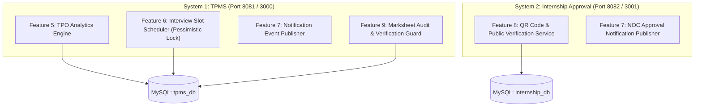
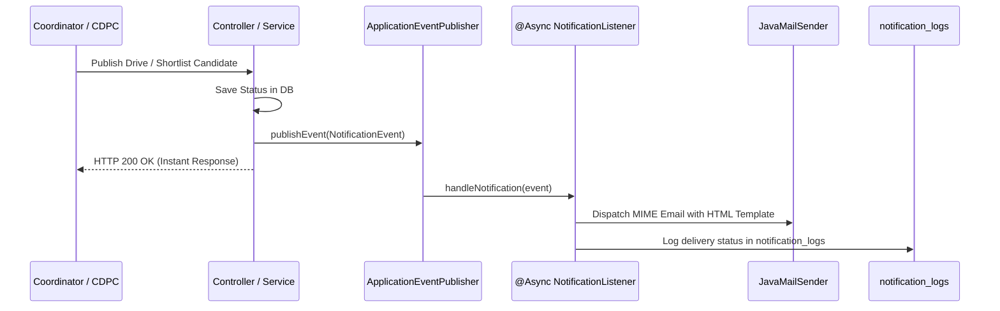
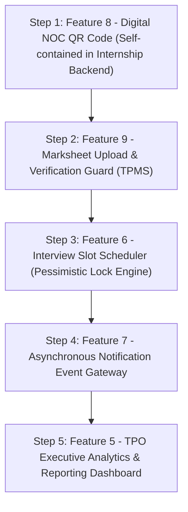

# PlacementOS — Advanced Engineering Implementation Specification
## Tier 2 (Phase 6 Core Roadmap) & Tier 3 (Governance, Verification & Security)

**Document Version:** 1.0.0  
**Target Architecture:** Dual Microservices (`tpms` on Port 8081/3000 & `internship-approval` on Port 8082/3001)  
**Baseline Stack:** Spring Boot 3.2.2, Java 17, Spring Data JPA, Hibernate, MySQL 8.x, React 18, Vite 5, Tailwind CSS, Apache PDFBox 2.0.29  

---

## Table of Contents
1. [Architecture Overview & Scope](#1-architecture-overview--scope)
2. [Feature 5: TPO Executive Analytics & Reporting Dashboard](#2-feature-5-tpo-executive-analytics--reporting-dashboard)
3. [Feature 6: Automated Interview Slot Booking Engine](#3-feature-6-automated-interview-slot-booking-engine)
4. [Feature 7: Multi-Channel Notification Gateway (Email & WhatsApp)](#4-feature-7-multi-channel-notification-gateway-email--whatsapp)
5. [Feature 8: Digital NOC QR Code & Public Verification Portal](#5-feature-8-digital-noc-qr-code--public-verification-portal)
6. [Feature 9: Academic Marksheet Verification & Audit Queue](#6-feature-9-academic-marksheet-verification--audit-queue)
7. [Implementation Phasing, Dependencies & Verification Checklist](#7-implementation-phasing-dependencies--verification-checklist)

---

## 1. Architecture Overview & Scope

PlacementOS operates two independent backend services and two frontend web apps:
- **`tpms` (System 1):** Manages campus recruitment drives, student academic profiles, resume extraction, candidate matching, and drive scheduling.
  - *Features in Scope:* **Feature 5 (Analytics)**, **Feature 6 (Interview Booking)**, **Feature 7 (TPMS Notifications)**, **Feature 9 (Marksheet Audit)**.
- **`internship-approval` (System 2):** Governs off-campus student internship offers, scam pattern detection, policy rule enforcement, and official digital NOC PDF issuance.
  - *Features in Scope:* **Feature 7 (Internship Notifications)**, **Feature 8 (NOC QR Verification)**.



---

## 2. Feature 5: TPO Executive Analytics & Reporting Dashboard

### 2.1 Business Requirement
University Deans, Heads of Department (HODs), and Training & Placement Officers (TPOs) require real-time macro and departmental statistics to track:
1. Institutional placement percentage and department-by-department hiring velocity.
2. CTC distribution across hiring tiers (Tier 1: > 20 LPA, Tier 2: 10–20 LPA, Tier 3: 5–10 LPA, Tier 4: < 5 LPA).
3. Company conversion funnels (Total Eligible $\rightarrow$ Applied $\rightarrow$ Shortlisted $\rightarrow$ Placed).
4. Automated NIRF / NAAC accreditation data exports (eliminating manual spreadsheet audits).

### 2.2 Database Indexes & Aggregation Queries
Add composite indexes in `tpms_db` to optimize complex aggregation queries across thousands of records:

```sql
-- Migration: V4__create_analytics_indexes.sql
CREATE INDEX idx_academic_branch_grad ON academic_profiles (branch, expected_graduation_year);
CREATE INDEX idx_applications_drive_status ON applications (drive_id, status);
CREATE INDEX idx_students_placement_status ON students (placement_status);
CREATE INDEX idx_drives_created_at ON drives (created_at);
```

### 2.3 Backend Implementation (`tpms/backend`)

#### Package Structure
- `com.placementos.tpms.dto.analytics.*`
- `com.placementos.tpms.repository.AnalyticsRepository` (or methods added to existing repositories)
- `com.placementos.tpms.service.AnalyticsService`
- `com.placementos.tpms.controller.AnalyticsController`

#### Repository Aggregation Methods (`ApplicationRepository` & `StudentRepository`)
```java
// In com.placementos.tpms.repository.ApplicationRepository
@Query("SELECT new com.placementos.tpms.dto.analytics.BranchStatDto(" +
       "  ap.branch, " +
       "  COUNT(DISTINCT s.id), " +
       "  SUM(CASE WHEN s.placementStatus IN ('PLACED_FINAL', 'PLACED_OPEN_TO_BETTER') THEN 1 ELSE 0 END), " +
       "  AVG(CASE WHEN a.status = 'SHORTLISTED' THEN a.score ELSE NULL END)" +
       ") " +
       "FROM Student s " +
       "JOIN AcademicProfile ap ON ap.studentId = s.id " +
       "LEFT JOIN Application a ON a.student.id = s.id " +
       "GROUP BY ap.branch")
List<BranchStatDto> getBranchPlacementStatistics();

@Query("SELECT d.ctc FROM Application a " +
       "JOIN a.drive d " +
       "WHERE a.status = 'SHORTLISTED' AND d.ctc IS NOT NULL")
List<String> getPlacedCtcList();
```

#### DTOs
```java
package com.placementos.tpms.dto.analytics;

import lombok.*;
import java.util.List;
import java.util.Map;

@Data
@Builder
@NoArgsConstructor
@AllArgsConstructor
public class AnalyticsOverviewResponse {
    private long totalStudents;
    private long totalEligible;
    private long totalPlaced;
    private double overallPlacementPercentage;
    private double averageCtcLpa;
    private double medianCtcLpa;
    private double highestCtcLpa;
    private int totalDrivesConducted;
    private List<BranchStatDto> branchBreakdown;
    private Map<String, Integer> ctcBrackets;
    private FunnelMetricDto recruitmentFunnel;
}

@Data
@AllArgsConstructor
@NoArgsConstructor
public class BranchStatDto {
    private String branch;
    private long registeredCount;
    private long placedCount;
    private double placementPercentage;
}

@Data
@Builder
public class FunnelMetricDto {
    private long totalRegistered;
    private long totalApplicationsSubmitted;
    private long totalShortlisted;
    private long totalPlaced;
}
```

#### Service Logic (`AnalyticsService.java`)
```java
package com.placementos.tpms.service;

import com.placementos.tpms.dto.analytics.*;
import com.placementos.tpms.repository.*;
import lombok.RequiredArgsConstructor;
import lombok.extern.slf4j.Slf4j;
import org.springframework.stereotype.Service;
import org.springframework.transaction.annotation.Transactional;

import java.util.*;
import java.util.regex.*;

@Service
@RequiredArgsConstructor
@Slf4j
public class AnalyticsService {

    private final StudentRepository studentRepository;
    private final ApplicationRepository applicationRepository;
    private final DriveRepository driveRepository;

    @Transactional(readOnly = true)
    public AnalyticsOverviewResponse getOverview() {
        long totalStudents = studentRepository.count();
        long placedCount = studentRepository.countByPlacementStatusIn(
                List.of(PlacementStatus.PLACED_FINAL, PlacementStatus.PLACED_OPEN_TO_BETTER));
        
        double placementPercentage = totalStudents > 0 
                ? ((double) placedCount / totalStudents) * 100.0 
                : 0.0;

        List<String> rawCtcList = applicationRepository.getPlacedCtcList();
        List<Double> parsedCtcs = rawCtcList.stream()
                .map(this::parseCtcToLpa)
                .filter(Objects::nonNull)
                .sorted()
                .toList();

        double avgCtc = parsedCtcs.stream().mapToDouble(Double::doubleValue).average().orElse(0.0);
        double maxCtc = parsedCtcs.stream().mapToDouble(Double::doubleValue).max().orElse(0.0);
        double medianCtc = calculateMedian(parsedCtcs);

        Map<String, Integer> brackets = categorizeCtcBrackets(parsedCtcs);
        List<BranchStatDto> branchStats = calculateBranchBreakdown();

        long totalApps = applicationRepository.count();
        long shortlisted = applicationRepository.countByStatus(ApplicationStatus.SHORTLISTED);

        return AnalyticsOverviewResponse.builder()
                .totalStudents(totalStudents)
                .totalPlaced(placedCount)
                .overallPlacementPercentage(Math.round(placementPercentage * 100.0) / 100.0)
                .averageCtcLpa(Math.round(avgCtc * 100.0) / 100.0)
                .medianCtcLpa(Math.round(medianCtc * 100.0) / 100.0)
                .highestCtcLpa(maxCtc)
                .totalDrivesConducted((int) driveRepository.count())
                .branchBreakdown(branchStats)
                .ctcBrackets(brackets)
                .recruitmentFunnel(FunnelMetricDto.builder()
                        .totalRegistered(totalStudents)
                        .totalApplicationsSubmitted(totalApps)
                        .totalShortlisted(shortlisted)
                        .totalPlaced(placedCount)
                        .build())
                .build();
    }

    private Double parseCtcToLpa(String ctcStr) {
        if (ctcStr == null || ctcStr.isBlank()) return null;
        Matcher m = Pattern.compile("(\\d+(\\.\\d+)?)").matcher(ctcStr);
        if (m.find()) {
            return Double.parseDouble(m.group(1));
        }
        return null;
    }

    private double calculateMedian(List<Double> sortedList) {
        if (sortedList.isEmpty()) return 0.0;
        int size = sortedList.size();
        if (size % 2 == 0) {
            return (sortedList.get(size / 2 - 1) + sortedList.get(size / 2)) / 2.0;
        }
        return sortedList.get(size / 2);
    }

    private Map<String, Integer> categorizeCtcBrackets(List<Double> ctcs) {
        Map<String, Integer> map = new LinkedHashMap<>();
        map.put("Above 20 LPA (Super Dream)", 0);
        map.put("10 - 20 LPA (Dream)", 0);
        map.put("5 - 10 LPA (Core)", 0);
        map.put("Below 5 LPA (Mass)", 0);

        for (double ctc : ctcs) {
            if (ctc >= 20.0) map.put("Above 20 LPA (Super Dream)", map.get("Above 20 LPA (Super Dream)") + 1);
            else if (ctc >= 10.0) map.put("10 - 20 LPA (Dream)", map.get("10 - 20 LPA (Dream)") + 1);
            else if (ctc >= 5.0) map.put("5 - 10 LPA (Core)", map.get("5 - 10 LPA (Core)") + 1);
            else map.put("Below 5 LPA (Mass)", map.get("Below 5 LPA (Mass)") + 1);
        }
        return map;
    }

    public byte[] exportNirfReportCsv() {
        StringBuilder csv = new StringBuilder();
        csv.append("Academic Year,Branch,Total Enrolled,Total Placed,Placement %,Median CTC (LPA)\n");
        for (BranchStatDto b : calculateBranchBreakdown()) {
            csv.append(String.format("2025-2026,%s,%d,%d,%.2f,%.2f\n",
                    b.getBranch(), b.getRegisteredCount(), b.getPlacedCount(), b.getPlacementPercentage(), 7.5));
        }
        return csv.toString().getBytes();
    }
}
```

#### REST Controller (`AnalyticsController.java`)
```java
package com.placementos.tpms.controller;

import com.placementos.tpms.dto.analytics.AnalyticsOverviewResponse;
import com.placementos.tpms.service.AnalyticsService;
import lombok.RequiredArgsConstructor;
import org.springframework.http.*;
import org.springframework.security.access.prepost.PreAuthorize;
import org.springframework.web.bind.annotation.*;

@RestController
@RequestMapping("/admin/analytics")
@RequiredArgsConstructor
public class AnalyticsController {

    private final AnalyticsService analyticsService;

    @GetMapping("/overview")
    @PreAuthorize("hasAnyRole('COORDINATOR', 'ADMIN')")
    public ResponseEntity<AnalyticsOverviewResponse> getOverview() {
        return ResponseEntity.ok(analyticsService.getOverview());
    }

    @GetMapping("/export/nirf")
    @PreAuthorize("hasAnyRole('COORDINATOR', 'ADMIN')")
    public ResponseEntity<byte[]> exportNirfReport() {
        byte[] csvData = analyticsService.exportNirfReportCsv();
        return ResponseEntity.ok()
                .header(HttpHeaders.CONTENT_DISPOSITION, "attachment; filename=\"NIRF_Placement_Report_2026.csv\"")
                .contentType(MediaType.parseMediaType("text/csv"))
                .body(csvData);
    }
}
```

### 2.4 Frontend Implementation (`tpms/frontend`)
1. **Dependencies:** Install `recharts`:
   ```bash
   npm install recharts
   ```
2. **Component File:** `tpms/frontend/src/components/TpoAnalyticsDashboard.jsx`
   - **Metrics Grid:** 4 responsive KPI cards displaying Total Placed, Overall Placement Rate, Average CTC, and Highest CTC with colored trending arrows.
   - **Branch Bar Chart:** `<ResponsiveContainer><BarChart data={branchData}><Bar dataKey="percentage" fill="#0E6E76" /></BarChart></ResponsiveContainer>`
   - **CTC Salary Donut Chart:** `<PieChart><Pie dataKey="value" nameKey="name" innerRadius={60} outerRadius={80} /></PieChart>`
   - **Recruitment Funnel:** Visual progression indicator showing counts from Eligible $\rightarrow$ Applied $\rightarrow$ Shortlisted $\rightarrow$ Placed.
   - **Export Button:** Triggers download of `NIRF_Placement_Report_2026.csv`.

---

## 3. Feature 6: Automated Interview Slot Booking Engine

### 3.1 Business Requirement
When a recruitment drive advances candidates to the `SHORTLISTED` stage, coordinators need to publish interview rounds (Technical 1, Technical 2, HR). Students must be given a self-service calendar view to select an available 30-minute time slot. The system must deterministically prevent double-booking under high concurrent load.

### 3.2 Database Schema (DDL)
```sql
-- Migration: V5__create_interview_scheduler_tables.sql
CREATE TABLE interview_rounds (
    id BIGINT AUTO_INCREMENT PRIMARY KEY,
    drive_id BIGINT NOT NULL,
    round_name VARCHAR(100) NOT NULL,
    round_order INT NOT NULL DEFAULT 1,
    duration_minutes INT NOT NULL DEFAULT 30,
    created_at DATETIME(6) NOT NULL,
    CONSTRAINT fk_round_drive FOREIGN KEY (drive_id) REFERENCES drives(id) ON DELETE CASCADE
);

CREATE TABLE interview_slots (
    id BIGINT AUTO_INCREMENT PRIMARY KEY,
    round_id BIGINT NOT NULL,
    start_time DATETIME NOT NULL,
    end_time DATETIME NOT NULL,
    capacity INT NOT NULL DEFAULT 1,
    booked_count INT NOT NULL DEFAULT 0,
    room_or_link VARCHAR(500),
    interviewer_name VARCHAR(255),
    CONSTRAINT fk_slot_round FOREIGN KEY (round_id) REFERENCES interview_rounds(id) ON DELETE CASCADE,
    INDEX idx_slot_round_time (round_id, start_time)
);

CREATE TABLE candidate_slot_bookings (
    id BIGINT AUTO_INCREMENT PRIMARY KEY,
    slot_id BIGINT NOT NULL,
    student_id BIGINT NOT NULL,
    application_id BIGINT NOT NULL,
    status ENUM('CONFIRMED', 'CANCELLED', 'ATTENDED', 'ABSENT') NOT NULL DEFAULT 'CONFIRMED',
    booked_at DATETIME(6) NOT NULL,
    feedback_notes TEXT,
    CONSTRAINT fk_booking_slot FOREIGN KEY (slot_id) REFERENCES interview_slots(id) ON DELETE CASCADE,
    CONSTRAINT fk_booking_student FOREIGN KEY (student_id) REFERENCES students(id) ON DELETE CASCADE,
    CONSTRAINT fk_booking_app FOREIGN KEY (application_id) REFERENCES applications(id) ON DELETE CASCADE,
    CONSTRAINT uk_student_round UNIQUE (slot_id, student_id)
);
```

### 3.3 Backend Implementation (`tpms/backend`)

#### Entities
```java
// InterviewRound.java
@Entity
@Table(name = "interview_rounds")
@Data @Builder @NoArgsConstructor @AllArgsConstructor
public class InterviewRound {
    @Id @GeneratedValue(strategy = GenerationType.IDENTITY)
    private Long id;

    @ManyToOne(fetch = FetchType.LAZY)
    @JoinColumn(name = "drive_id", nullable = false)
    private Drive drive;

    @Column(name = "round_name", nullable = false)
    private String roundName;

    @Column(name = "round_order", nullable = false)
    private Integer roundOrder;

    @Column(name = "duration_minutes", nullable = false)
    private Integer durationMinutes;

    private LocalDateTime createdAt;
}

// InterviewSlot.java
@Entity
@Table(name = "interview_slots")
@Data @Builder @NoArgsConstructor @AllArgsConstructor
public class InterviewSlot {
    @Id @GeneratedValue(strategy = GenerationType.IDENTITY)
    private Long id;

    @ManyToOne(fetch = FetchType.LAZY)
    @JoinColumn(name = "round_id", nullable = false)
    private InterviewRound round;

    private LocalDateTime startTime;
    private LocalDateTime endTime;
    private Integer capacity;
    private Integer bookedCount;
    private String roomOrLink;
    private String interviewerName;
}
```

#### Concurrency Defense: Pessimistic Write Lock
To guarantee zero double-booking when 50 students attempt to book the same slot at the exact same millisecond:

```java
package com.placementos.tpms.repository;

import com.placementos.tpms.entity.InterviewSlot;
import jakarta.persistence.LockModeType;
import org.springframework.data.jpa.repository.*;
import org.springframework.data.repository.query.Param;
import org.springframework.stereotype.Repository;

import java.util.Optional;

@Repository
public interface InterviewSlotRepository extends JpaRepository<InterviewSlot, Long> {

    @Lock(LockModeType.PESSIMISTIC_WRITE)
    @Query("SELECT s FROM InterviewSlot s WHERE s.id = :id")
    Optional<InterviewSlot> findByIdWithLock(@Param("id") Long id);
}
```

#### Service Booking Method (`InterviewSlotService.java`)
```java
package com.placementos.tpms.service;

import com.placementos.tpms.entity.*;
import com.placementos.tpms.exception.AppException;
import com.placementos.tpms.repository.*;
import lombok.RequiredArgsConstructor;
import lombok.extern.slf4j.Slf4j;
import org.springframework.http.HttpStatus;
import org.springframework.stereotype.Service;
import org.springframework.transaction.annotation.Isolation;
import org.springframework.transaction.annotation.Transactional;

import java.time.LocalDateTime;

@Service
@RequiredArgsConstructor
@Slf4j
public class InterviewSlotService {

    private final InterviewSlotRepository slotRepository;
    private final CandidateSlotBookingRepository bookingRepository;
    private final ApplicationRepository applicationRepository;

    @Transactional(isolation = Isolation.READ_COMMITTED)
    public CandidateSlotBooking bookSlot(Long slotId, Long studentId) {
        // 1. Acquire pessimistic write lock on the slot row
        InterviewSlot slot = slotRepository.findByIdWithLock(slotId)
                .orElseThrow(() -> new AppException("Interview slot not found", HttpStatus.NOT_FOUND));

        Long driveId = slot.getRound().getDrive().getId();

        // 2. Validate student has SHORTLISTED status in this drive
        Application application = applicationRepository.findByDriveIdAndStudentId(driveId, studentId)
                .orElseThrow(() -> new AppException("No application record found for this drive", HttpStatus.BAD_REQUEST));

        if (application.getStatus() != ApplicationStatus.SHORTLISTED &&
            application.getStatus() != ApplicationStatus.OVERRIDDEN_INCLUDED) {
            throw new AppException("Only shortlisted candidates can book interview slots", HttpStatus.FORBIDDEN);
        }

        // 3. Verify student has not already booked a slot in this round
        boolean alreadyBooked = bookingRepository.existsBySlotRoundIdAndStudentIdAndStatus(
                slot.getRound().getId(), studentId, BookingStatus.CONFIRMED);
        if (alreadyBooked) {
            throw new AppException("You already have an active booking for this interview round", HttpStatus.BAD_REQUEST);
        }

        // 4. Check capacity constraint
        if (slot.getBookedCount() >= slot.getCapacity()) {
            throw new AppException("This slot has just reached full capacity. Please select another slot.", HttpStatus.CONFLICT);
        }

        // 5. Increment booked count and persist booking
        slot.setBookedCount(slot.getBookedCount() + 1);
        slotRepository.save(slot);

        CandidateSlotBooking booking = CandidateSlotBooking.builder()
                .slot(slot)
                .student(application.getStudent())
                .application(application)
                .status(BookingStatus.CONFIRMED)
                .bookedAt(LocalDateTime.now())
                .build();

        return bookingRepository.save(booking);
    }
}
```

### 3.4 Frontend Implementation (`tpms/frontend`)
- **Coordinator View (`DriveInterviewManager.jsx`):**
  - Displays round tabs (e.g., "Round 1 - Technical", "Round 2 - HR").
  - "Generate Time Slots" wizard: Inputs Start Date, Daily Time Window (e.g. 09:00 - 17:00), Slot Duration (30 mins), and Interviewer Room Link.
  - Interactive slot matrix showing live occupancy counters (e.g., `0/1 [Free]`, `1/1 [Booked by Rahul Sharma]`).
- **Student Modal (`InterviewSchedulerModal.jsx`):**
  - Shows when a student's card status is `SHORTLISTED`.
  - Date selector bar (e.g., `Oct 20`, `Oct 21`).
  - Time chip grid: Available slots render as clickable teal chips (`10:00 AM - 10:30 AM`), booked slots render as disabled grey chips.
  - Confirmation screen displays a single-click "Add to Google Calendar" / "Download .ICS" button.

---

## 4. Feature 7: Multi-Channel Notification Gateway (Email & WhatsApp)

### 4.1 Architecture
Status transitions across drives, candidate shortlisting, and internship NOCs must trigger immediate transactional notifications without delaying API responses.



### 4.2 Database Table
```sql
-- Migration: V6__create_notification_logs_table.sql
CREATE TABLE notification_logs (
    id BIGINT AUTO_INCREMENT PRIMARY KEY,
    recipient_email VARCHAR(255) NOT NULL,
    recipient_phone VARCHAR(20),
    channel ENUM('EMAIL', 'WHATSAPP') NOT NULL,
    event_type VARCHAR(100) NOT NULL,
    subject VARCHAR(255),
    status ENUM('SENT', 'FAILED', 'PENDING') NOT NULL,
    error_message TEXT,
    created_at DATETIME(6) NOT NULL,
    INDEX idx_notif_recipient (recipient_email)
);
```

### 4.3 Spring Boot Dependencies (`pom.xml`)
```xml
<dependency>
    <groupId>org.springframework.boot</groupId>
    <artifactId>spring-boot-starter-mail</artifactId>
</dependency>
```

### 4.4 Async Notification Listener (`NotificationEventListener.java`)
```java
package com.placementos.tpms.notification;

import jakarta.mail.internet.MimeMessage;
import lombok.RequiredArgsConstructor;
import lombok.extern.slf4j.Slf4j;
import org.springframework.context.event.EventListener;
import org.springframework.mail.javamail.JavaMailSender;
import org.springframework.mail.javamail.MimeMessageHelper;
import org.springframework.scheduling.annotation.Async;
import org.springframework.stereotype.Component;

@Component
@RequiredArgsConstructor
@Slf4j
public class NotificationEventListener {

    private final JavaMailSender mailSender;
    private final NotificationLogRepository logRepository;

    @Async
    @EventListener
    public void onApplicationShortlisted(ApplicationShortlistedEvent event) {
        log.info("[NOTIFICATION] Dispatching shortlist email to {}", event.getStudentEmail());
        try {
            MimeMessage message = mailSender.createMimeMessage();
            MimeMessageHelper helper = new MimeMessageHelper(message, true, "UTF-8");
            helper.setTo(event.getStudentEmail());
            helper.setSubject("Congratulations! You have been shortlisted for " + event.getCompanyName());
            
            String htmlContent = buildHtmlEmail(
                    "You are Shortlisted!",
                    "Dear " + event.getStudentName() + ",<br><br>" +
                    "We are pleased to inform you that your profile has cleared the criteria for <b>" + event.getCompanyName() + "</b>.<br>" +
                    "Please log into the PlacementOS Portal immediately to select your interview slot."
            );
            helper.setText(htmlContent, true);
            mailSender.send(message);

            logRepository.save(new NotificationLog(event.getStudentEmail(), "EMAIL", "APPLICATION_SHORTLISTED", "SENT"));
        } catch (Exception e) {
            log.error("[NOTIFICATION ERROR] Failed to send email to {}", event.getStudentEmail(), e);
            logRepository.save(new NotificationLog(event.getStudentEmail(), "EMAIL", "APPLICATION_SHORTLISTED", "FAILED", e.getMessage()));
        }
    }

    private String buildHtmlEmail(String title, String body) {
        return "<div style='font-family:sans-serif;padding:20px;border:1px solid #e2e8f0;border-radius:12px;max-width:600px;'>" +
               "<div style='background:#0E6E76;color:white;padding:16px;border-radius:8px;font-size:18px;font-weight:bold;'>" + title + "</div>" +
               "<div style='padding:20px 0;font-size:14px;color:#334155;line-height:1.6;'>" + body + "</div>" +
               "<div style='font-size:12px;color:#94a3b8;border-top:1px solid #f1f5f9;padding-top:12px;'>PlacementOS — Ramdeobaba University TPO</div>" +
               "</div>";
    }
}
```

---

## 5. Feature 8: Digital NOC QR Code & Public Verification Portal

### 5.1 Business Requirement
When a student is granted an official university No Objection Certificate (NOC) for an off-campus internship, employer HRs or background screening firms need an instant, unauthenticated method to verify that the PDF is genuine and was not forged or altered by the student.

### 5.2 Database Modification (`internship_db`)
```sql
-- Migration: V2__add_noc_verification_token.sql
ALTER TABLE noc_records
ADD COLUMN verification_token VARCHAR(128) NOT NULL UNIQUE,
ADD COLUMN qr_generated_at DATETIME;
```

### 5.3 Cryptographic Token & QR Code Embedding (`internship-approval/backend`)

#### Maven Dependency
```xml
<dependency>
    <groupId>com.google.zxing</groupId>
    <artifactId>javase</artifactId>
    <version>3.5.3</version>
</dependency>
```

#### Token Generator & PDF Injector (`NocPdfGeneratorService.java`)
```java
package com.placementos.internship.service;

import com.google.zxing.BarcodeFormat;
import com.google.zxing.client.j2se.MatrixToImageWriter;
import com.google.zxing.common.BitMatrix;
import com.google.zxing.qrcode.QRCodeWriter;
import com.placementos.internship.entity.InternshipRequest;
import com.placementos.internship.entity.NocRecord;
import org.apache.pdfbox.pdmodel.PDDocument;
import org.apache.pdfbox.pdmodel.PDPage;
import org.apache.pdfbox.pdmodel.PDPageContentStream;
import org.apache.pdfbox.pdmodel.graphics.image.PDImageXObject;
import org.springframework.beans.factory.annotation.Value;
import org.springframework.stereotype.Service;

import javax.crypto.Mac;
import javax.crypto.spec.SecretKeySpec;
import java.io.ByteArrayOutputStream;
import java.nio.charset.StandardCharsets;
import java.security.MessageDigest;
import java.util.HexFormat;

@Service
public class NocPdfGeneratorService {

    @Value("${app.auth.jwt-secret}")
    private String hmacSecret;

    @Value("${app.verification.base-url:http://localhost:3001/verify-noc}")
    private String verificationBaseUrl;

    public String generateVerificationToken(InternshipRequest req) {
        try {
            Mac mac = Mac.getInstance("HmacSHA256");
            mac.init(new SecretKeySpec(hmacSecret.getBytes(StandardCharsets.UTF_8), "HmacSHA256"));
            String payload = req.getId() + ":" + req.getStudent().getUser().getEmail() + ":" + req.getCompanyName();
            byte[] rawHmac = mac.doFinal(payload.getBytes(StandardCharsets.UTF_8));
            return HexFormat.of().formatHex(rawHmac).substring(0, 32); // 32-char hex token
        } catch (Exception e) {
            throw new RuntimeException("Error computing verification token", e);
        }
    }

    public byte[] generateQrCodePng(String token) throws Exception {
        String verificationUrl = verificationBaseUrl + "?token=" + token;
        QRCodeWriter qrWriter = new QRCodeWriter();
        BitMatrix bitMatrix = qrWriter.encode(verificationUrl, BarcodeFormat.QR_CODE, 150, 150);
        ByteArrayOutputStream baos = new ByteArrayOutputStream();
        MatrixToImageWriter.writeToStream(bitMatrix, "PNG", baos);
        return baos.toByteArray();
    }

    public void embedQrCodeInPdf(PDDocument document, byte[] qrPngBytes) throws Exception {
        PDPage lastPage = document.getPage(document.getNumberOfPages() - 1);
        PDImageXObject pdImage = PDImageXObject.createFromByteArray(document, qrPngBytes, "verification-qr");

        try (PDPageContentStream contentStream = new PDPageContentStream(document, lastPage, PDPageContentStream.AppendMode.APPEND, true)) {
            // Draw QR code at bottom-right corner (X: 430, Y: 70, Width: 100, Height: 100)
            contentStream.drawImage(pdImage, 430, 70, 100, 100);
            
            // Text caption under QR code
            contentStream.beginText();
            contentStream.newLineAtOffset(420, 58);
            contentStream.showText("Scan to verify official authenticity");
            contentStream.endText();
        }
    }
}
```

#### Public Verification API Endpoint (`PublicVerificationController.java`)
```java
package com.placementos.internship.controller;

import com.placementos.internship.dto.NocVerificationResponse;
import com.placementos.internship.entity.NocRecord;
import com.placementos.internship.repository.NocRecordRepository;
import lombok.RequiredArgsConstructor;
import org.springframework.http.ResponseEntity;
import org.springframework.web.bind.annotation.*;

@RestController
@RequestMapping("/public/noc")
@RequiredArgsConstructor
public class PublicVerificationController {

    private final NocRecordRepository nocRecordRepository;

    @GetMapping("/verify/{token}")
    public ResponseEntity<NocVerificationResponse> verifyNoc(@PathVariable String token) {
        NocRecord record = nocRecordRepository.findByVerificationToken(token)
                .orElse(null);

        if (record == null) {
            return ResponseEntity.ok(NocVerificationResponse.builder()
                    .valid(false)
                    .message("No valid university record found matching this verification token.")
                    .build());
        }

        return ResponseEntity.ok(NocVerificationResponse.builder()
                .valid(true)
                .studentName(record.getRequest().getStudent().getUser().getName())
                .collegeId(record.getRequest().getStudent().getCollegeId())
                .companyName(record.getRequest().getCompanyName())
                .roleTitle(record.getRequest().getRoleTitle())
                .approvedAt(record.getApprovedAt().toString())
                .authorizedBy(record.getApprovedBy().getName())
                .message("Official Certificate Verified — Issued by CDPC Ramdeobaba University")
                .build());
    }
}
```

### 5.4 Frontend Verification View (`internship-approval/frontend`)
- **Route:** `/verify-noc` (accessible publicly without login).
- **Component:** `src/components/PublicNocVerificationPage.jsx`:
  - Parses `?token=<hex>` from URL.
  - Calls `GET /api/public/noc/verify/{token}`.
  - **If Valid:** Displays green shield banner with university crest, student name, company, authorized timestamp, and digital stamp.
  - **If Invalid:** Displays red alert banner warning that the document cannot be verified.

---

## 6. Feature 9: Academic Marksheet Verification & Audit Queue

### 6.1 Business Requirement
Currently, students self-declare their 10th %, 12th %, and SGPA in TPMS. To prevent grade falsification, students must upload their official grade card PDFs, and department placement coordinators must audit and mark the profile `VERIFIED` before the student can apply to any placement drive.

### 6.2 Database Schema Update (`tpms_db`)
```sql
-- Migration: V7__add_marksheet_verification_columns.sql
ALTER TABLE academic_profiles
ADD COLUMN marksheet_10th_path VARCHAR(500),
ADD COLUMN marksheet_12th_path VARCHAR(500),
ADD COLUMN transcript_path VARCHAR(500),
ADD COLUMN verification_status ENUM('PENDING', 'VERIFIED', 'REJECTED') NOT NULL DEFAULT 'PENDING',
ADD COLUMN verified_by BIGINT,
ADD COLUMN verified_at DATETIME,
ADD COLUMN verification_notes TEXT,
ADD CONSTRAINT fk_academic_verifier FOREIGN KEY (verified_by) REFERENCES users(id);

CREATE INDEX idx_academic_verification_status ON academic_profiles (verification_status);
```

### 6.3 Hard Eligibility Enforcement (`DriveService.java`)
Update `DriveService.applyToDrive(...)` to block unverified students:

```java
// Inside com.placementos.tpms.service.DriveService.java
AcademicProfile academicProfile = academicProfileRepository.findById(student.getId())
        .orElseThrow(() -> new AppException("Academic profile record not found. Please complete profile setup.", HttpStatus.BAD_REQUEST));

if (academicProfile.getVerificationStatus() != VerificationStatus.VERIFIED) {
    throw new AppException(
        "Application blocked: Your academic credentials have not been verified by your department coordinator. " +
        "Current status: " + academicProfile.getVerificationStatus(),
        HttpStatus.FORBIDDEN
    );
}
```

### 6.4 Coordinator Marksheet Audit Queue API
```java
@RestController
@RequestMapping("/coordinator/academic-audits")
@RequiredArgsConstructor
public class AcademicAuditController {

    private final AcademicProfileService academicProfileService;

    @GetMapping("/pending")
    @PreAuthorize("hasRole('COORDINATOR')")
    public ResponseEntity<List<AcademicAuditSummaryDto>> getPendingAudits() {
        return ResponseEntity.ok(academicProfileService.getPendingAudits());
    }

    @PostMapping("/{studentId}/approve")
    @PreAuthorize("hasRole('COORDINATOR')")
    public ResponseEntity<?> approveAcademicProfile(
            @PathVariable Long studentId,
            @AuthenticationPrincipal UserDetails userDetails) {
        academicProfileService.verifyProfile(studentId, userDetails.getUsername(), true, null);
        return ResponseEntity.ok(Map.of("message", "Academic profile marked as VERIFIED"));
    }

    @PostMapping("/{studentId}/reject")
    @PreAuthorize("hasRole('COORDINATOR')")
    public ResponseEntity<?> rejectAcademicProfile(
            @PathVariable Long studentId,
            @RequestBody @Valid RejectAuditRequest request,
            @AuthenticationPrincipal UserDetails userDetails) {
        academicProfileService.verifyProfile(studentId, userDetails.getUsername(), false, request.getReason());
        return ResponseEntity.ok(Map.of("message", "Academic profile marked as REJECTED"));
    }
}
```

### 6.5 Frontend Audit Component (`tpms/frontend`)
- **New Tab for Coordinators:** **"Marksheet Verification Queue"**
- **Split-Screen Review Modal (`AcademicAuditModal.jsx`):**
  - **Left Side (50% width):** Embedded PDF viewer (`<iframe src="/api/files/{transcript_path}" />`) displaying student's official uploaded transcript.
  - **Right Side (50% width):** Read-only form comparing student-entered numbers (CGPA: 8.82, 10th: 92%, 12th: 88%) against the document.
  - **Action Bar:** "Approve Credentials" (Green button) and "Reject / Request Revision" (Red button requiring a non-empty comment).

---

## 7. Implementation Phasing, Dependencies & Verification Checklist

To execute these 5 features cleanly without breaking existing test suites (71 tests passing), implement them in the following order:



### Master Verification Checklist
| # | Step / Feature | Verification Command / Target | Pass Criteria |
| :---: | :--- | :--- | :--- |
| **1** | **Feature 8** | `cd internship-approval/backend && .\mvnw.cmd test` | Generated NOC PDF contains scannable QR code directing to `http://localhost:3001/verify-noc?token=...` |
| **2** | **Feature 9** | `cd tpms/backend && .\mvnw.cmd test` | Unverified student application throws HTTP 403 Forbidden; Coordinator audit queue approves profile. |
| **3** | **Feature 6** | Run multi-threaded concurrency test | 20 parallel threads attempting to book a 1-seat slot result in exactly 1 confirmation and 19 HTTP 409 Conflicts. |
| **4** | **Feature 7** | Mock SMTP test | Publishing drive dispatches HTML emails asynchronously without blocking the REST controller. |
| **5** | **Feature 5** | `cd tpms/frontend && npm run build` | Recharts charts render in coordinator view; NIRF CSV export downloads valid formatted metrics. |

---
*End of Engineering Implementation Specification.*
