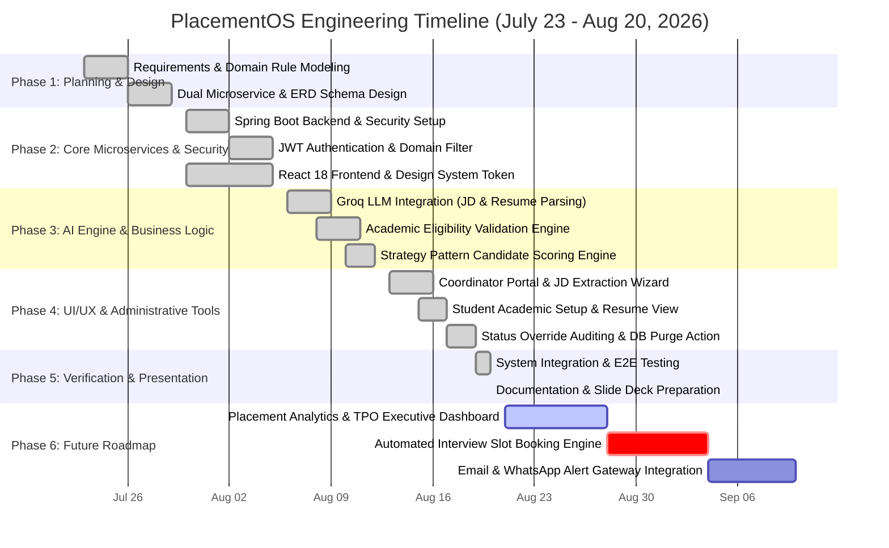

# PlacementOS — Project Development Timeline & Presentation Roadmap

**Project Title:** PlacementOS (Training & Placement Management System - TPMS & Internship Approval System)  
**Development Window:** July 23, 2026 – August 20, 2026 (Current Baseline)  
**Timeline Model:** 4-Week Agile Development Sprint + Future Engineering Roadmap  

---

## 1. Visual Gantt Chart (Mermaid Diagram)

---

## 2. Detailed Week-by-Week Development Breakdown

### Phase 1: Problem Definition, Architecture & Database Design
**Duration:** July 23, 2026 – July 29, 2026 (Week 1)
- **Jul 23 – Jul 25:** Conducted domain analysis on campus placement workflows (`@rknec.edu` requirements). Identified core pain points: manual resume filtering, transparent eligibility enforcement, and internship approvals.
- **Jul 26 – Jul 27:** Architecture blueprinting — decided on a dual-microservice design (TPMS for campus drives & scoring; Internship Approval for NOC workflows).
- **Jul 28 – Jul 29:** Relational Database Schema Design (Users, Academic Profiles, SGPA tracking, Backlog records, Role Profiles, Drive criteria, Application status audit logs).

### Phase 2: Microservice Scaffolding, Security & Frontend Design System
**Duration:** July 30, 2026 – August 5, 2026 (Week 2)
- **Jul 30 – Aug 01:** Initialized Spring Boot 3.x microservices with Java 17 & Maven. Configured relational persistence layer (Spring Data JPA, Hibernate, MySQL/Oracle/H2).
- **Aug 02 – Aug 03:** Implemented Spring Security with JWT stateless authentication. Built domain enforcement filter restricting user registration strictly to `@rknec.edu`.
- **Aug 04 – Aug 05:** Frontend React 18 + Vite repository setup. Designed custom Vanilla CSS design system (dark/glassmorphism theme, HSL color tokens, responsive navigation shell).

### Phase 3: AI Parsing Infrastructure & Core Rule Engines
**Duration:** August 6, 2026 – August 12, 2026 (Week 3)
- **Aug 06 – Aug 08:** Groq LLM API Integration (`llama-3.3-70b-versatile`). Engineered JSON extraction prompts for unstructured Job Descriptions (extracting required skills, weights, and cutoffs).
- **Aug 09 – Aug 10:** Extended Groq LLM engine to parse student PDF resumes (extracting skills, DSA project details, LeetCode handles, certifications). Implemented offline mock fallback for resilience.
- **Aug 11 – Aug 12:** Developed the **Academic Eligibility Engine** (blocking applications failing CGPA, 10th %, 12th %, or active backlogs) and the **Strategy Pattern Scoring Engine** (calculating 0-100 composite candidate fit scores).

### Phase 4: Full Portal Integration, Auditing & Administrative Control
**Duration:** August 13, 2026 – August 18, 2026 (Week 4)
- **Aug 13 – Aug 15:** Developed Coordinator Portal UI: 3-Step Drive Creation Wizard (Basic Info $\rightarrow$ Raw JD Extractor $\rightarrow$ Interactive Skill & Cutoff Editor).
- **Aug 16 – Aug 17:** Developed Student Portal UI: Academic profile onboarding, semester SGPA grid, live drive application cards with real-time eligibility feedback.
- **Aug 18:** Implemented Candidate Status Override audit logging (forcing inclusions/exclusions with mandatory justification text) and Administrative Database Purge functionality with confirmation modals.

### Phase 5: End-to-End Verification, Optimization & Documentation
**Duration:** August 19, 2026 – August 20, 2026 (Current Baseline)
- **Aug 19:** Comprehensive E2E testing across multi-role workflows (Student registration $\rightarrow$ Profile setup $\rightarrow$ Coordinator JD extraction $\rightarrow$ Eligibility check blocking $\rightarrow$ Candidate matrix ranking $\rightarrow$ Audit overrides).
- **Aug 20:** Performance polish, case-insensitive role access fixes, system architecture report generation (`PROJECT_DOCUMENTATION_REPORT.md`), and presentation preparation.

---

## 3. What's Implemented vs. What's Next (Presentation Slide Content)

| Module / Area | Feature Status | Description / Scope |
| :--- | :--- | :--- |
| **Authentication & RBAC** | ✅ **Implemented** | `@rknec.edu` domain filter, JWT auth, `STUDENT`/`COORDINATOR`/`ADMIN` roles |
| **AI Job Description Parsing** | ✅ **Implemented** | Groq LLM prompt extracting skills taxonomy, scoring weights & academic cutoffs |
| **AI Resume Parsing** | ✅ **Implemented** | PDF parsing, skill normalization, DSA section extraction, handle indexing |
| **Eligibility Rule Engine** | ✅ **Implemented** | Deterministic blocking for CGPA, 10th %, 12th %, and active backlogs |
| **Candidate Scoring Matrix** | ✅ **Implemented** | Strategy pattern composite score (0-100), rank matrix, override audit log |
| **Admin DB Purge & Drive Actions** | ✅ **Implemented** | One-click database purge modal and single-drive deletion management |
| **Placement Analytics & TPO Dashboard**| ⏳ **Phase 6 (Next)** | Aggregate stats on placement ratios, average CTC, department-wise charts |
| **Interview Slot Booking System** | ⏳ **Phase 6 (Next)** | Self-service scheduling for shortlist candidates with conflict resolution |
| **Notification Gateway** | ⏳ **Phase 6 (Next)** | Automated Email & WhatsApp alerts for shortlisted candidates |
| **CI/CD & Containerization** | ⏳ **Phase 6 (Next)** | Docker multi-stage builds, Kubernetes deployment manifests, GitHub Actions |

---

## 4. How to Present This Timeline (Slide-by-Slide Strategy)

### Slide 1: Development Timeline & Milestones
- **Layout:** Use 4 horizontal chevron blocks or the Mermaid Gantt chart.
- **Key Takeaway:** *"PlacementOS was engineered over a structured 4-week Agile development cycle, progressing from core database architecture to AI integration and frontend dashboards."*

### Slide 2: Feature Matrix (What is Completed vs. Upcoming)
- **Left Column (Current Release - v1.0.0):** AI JD/Resume Extraction, Deterministic Eligibility Engine, Strategy Scoring Matrix, Audit Overrides.
- **Right Column (Upcoming Phase 2 Roadmap):** TPO Analytics Dashboard, Automated Interview Slot Scheduling, Email Alert Gateway.

### Slide 3: Defense / Speaker Notes (Handling Panel Questions)
- **Q: "Why did development take 4 weeks?"**
  - **Answer:** *"Week 1 was dedicated to domain modeling and security design for campus constraints (`@rknec.edu`). Weeks 2 and 3 focused on building robust backends and integrating Groq LLM structured JSON output. Week 4 focused on UI workflow integration, audit override logs, and rigorous testing."*
- **Q: "What are the immediate next steps?"**
  - **Answer:** *"We are moving into Phase 6 to build the TPO Executive Analytics Dashboard, integrate email notifications for drive updates, and containerize the dual microservices using Docker."*
