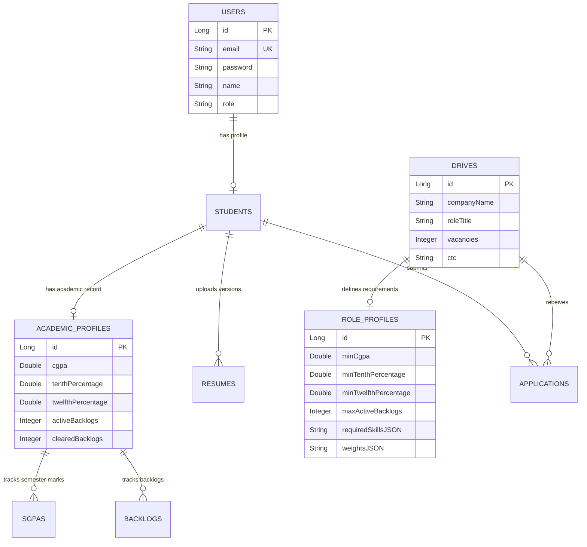

# PlacementOS — System Architecture & Technical Implementation Report

**Project Title:** PlacementOS (Training & Placement Management System - TPMS & Internship Approval System)  
**Target Domain:** Campus Placement Automation & Deterministic Matching System (`@rknec.edu`)  
**Document Version:** 1.0.0  
**Generated Date:** August 20, 2026  

---

## 1. Executive Summary

**PlacementOS** is an enterprise-grade, dual-microservice web application engineered to automate, streamline, and transparently manage college campus recruitment drives and internship approval workflows. 

The system leverages **Groq Large Language Models (LLM)** to parse unstructured Job Descriptions (JDs) and student PDF resumes into structured data points. It features a **Strategy-Pattern Candidate Scoring Engine** and strict **Academic Eligibility Validation Rules** that evaluate candidates against cutoffs (CGPA, 10th %, 12th %, and Active Backlogs) before enabling placement drive participation.

---

## 2. Technical Stack & Architecture

### Backend Architecture
- **Framework:** Spring Boot 3.x with Java 21
- **Security:** Spring Security + Stateless JWT Authentication & Role-Based Access Control (RBAC)
- **Persistence:** Spring Data JPA / Hibernate with Relational Database (MySQL / Oracle / H2)
- **AI / LLM Integration:** Groq Cloud API (`llama-3.3-70b-versatile` / `llama3-70b-8192`) with JSON schema enforcement and robust offline mock fallback
- **Build System:** Apache Maven

### Frontend Architecture
- **Framework:** React 18 with Vite
- **Styling:** Vanilla CSS design system with custom HSL palette, dark/glassmorphic aesthetics, and responsive layout
- **Icons & UI:** Lucide React Icon Library
- **State Management:** React Context API (`AuthContext`) & Local Storage session persistence

---

## 3. Core System Modules & Features Implemented

### Module 1: Campus Identity & Access Control
- **Domain Enforcement:** Registration restricted strictly to `@rknec.edu` email domain addresses.
- **Role Hierarchy:**
  - `STUDENT`: Complete academic profile, upload resumes, view drive cutoffs, apply to drives, inspect transparent rejection feedback.
  - `COORDINATOR` / `TPO` / `ADMIN`: Extract JDs via LLM, review/edit extracted criteria, publish placement drives, trigger candidate scoring algorithms, execute candidate status overrides with mandatory audit logs, and perform DB purges.

### Module 2: AI-Driven Job Description (JD) Extraction
- **Text & File Processing:** Accepts raw JD text or uploaded documents (`.pdf`, `.txt`, `.docx`).
- **Structured JSON Extraction:** Groq LLM parses raw JDs to automatically extract:
  1. **Technical Skills Taxonomy:** `MUST_HAVE`, `NICE_TO_HAVE`, `BONUS`.
  2. **Scoring Weights:** Relative weight distribution across `skillMatch`, `projectRelevance`, `codingActivity`, `certifications`, `experience`.
  3. **Extracted Academic Criteria:** `minCgpa`, `minTenthPercentage`, `minTwelfthPercentage`, `maxActiveBacklogs`.
- **Interactive Review Step:** Allows coordinators to inspect, edit, or adjust extracted requirements prior to publishing the drive.

### Module 3: Student Onboarding & Resume Parsing
- **Academic Setup:** Students record aggregate CGPA, semester-wise SGPA history, 10th and 12th percentages, and active/cleared backlog counts.
- **Resume Skill Extraction:** Groq LLM parses uploaded PDF resumes, extracting technical skills, DSA project descriptions, certifications, and coding profile handles (LeetCode, CodeChef, GitHub).

### Module 4: Academic Eligibility Validation Engine
- **DB-Level Enforcement:** Integrated directly into `DriveService.applyToDrive`.
- **Validation Pipeline:** When a student clicks **Apply**, the system evaluates:
  $$\text{Student CGPA} \ge \text{Min CGPA}$$
  $$\text{10th Percentage} \ge \text{Min 10th \%}$$
  $$\text{12th Percentage} \ge \text{Min 12th \%}$$
  $$\text{Active Backlogs} \le \text{Max Active Backlogs}$$
- **Rejection Transparency:** If ineligible, the application request is rejected with `400 Bad Request` and a descriptive message (e.g., *"Ineligible: Student CGPA (7.20) is below requirement (7.50)"*).

### Module 5: Strategy-Pattern Candidate Scoring & Shortlisting
- **Scoring Engine:** Calculates a weighted composite score ($0.0 - 100.0$) for eligible candidates based on skill overlap, project relevance, and coding activities.
- **Shortlist Matrix:** Ranks candidates dynamically and assigns `SHORTLISTED` or `NOT_SHORTLISTED` status based on available vacancies.
- **Coordinator Override Audit:** Coordinators can force include (`OVERRIDDEN_INCLUDED`) or force exclude (`OVERRIDDEN_EXCLUDED`) candidates, requiring a mandatory written justification stored for audit purposes.

### Module 6: Administrative Maintenance & DB Purge
- **Database Purge Action:** Provides coordinators with a secure, one-click database reset modal that purges student profiles, academic histories, backlogs, uploaded resumes, placement drives, and application records while respecting foreign key constraints.
- **Single Drive Deletion:** Individual placement drives can be deleted directly from drive cards via a custom confirmation modal.

---

## 4. Database Schema & Data Model

---

## 5. Main API Endpoints Reference

| HTTP Method | Endpoint Path | Role Allowed | Description |
| :--- | :--- | :--- | :--- |
| `POST` | `/api/auth/register` | Public | Register new user (`@rknec.edu`) |
| `POST` | `/api/auth/login` | Public | Authenticate user & issue JWT token |
| `GET` | `/api/students/{id}/profile` | Student / Staff | Fetch comprehensive student profile |
| `PUT` | `/api/students/{id}/profile` | Student | Update academic & profile details |
| `POST` | `/api/resumes/upload` | Student | Upload resume PDF for LLM extraction |
| `GET` | `/api/drives` | Authenticated | Retrieve all placement drives |
| `POST` | `/api/drives/extract-jd` | Staff | Send raw JD text to Groq LLM for extraction |
| `POST` | `/api/drives` | Staff | Publish new drive with extracted profile |
| `DELETE` | `/api/drives/{id}` | Staff | Delete placement drive & related applications |
| `POST` | `/api/drives/{id}/apply` | Student | Apply to drive (triggers eligibility check) |
| `POST` | `/api/drives/{id}/rank` | Staff | Trigger candidate scoring & ranking algorithm |
| `POST` | `/api/applications/{id}/override` | Staff | Override candidate status with mandatory reason |
| `POST` | `/api/admin/data/cleanup` | Staff | Execute full administrative database purge |

---

## 6. Frontend Component Architecture

1. **`Navbar.jsx`**: Top navigation header featuring normalized case-insensitive role checks (`isStaff`, `isStudent`), tab switching, and the **Purge Student DB** button.
2. **`App.jsx`**: Main application shell, state management for user authentication, placement drive overview rendering with extracted skill/criteria badges, and drive deletion modal.
3. **`CreateDriveView.jsx`**: Drive creation wizard with step-by-step guidance:
   - Step 1: Basic Company & Drive Info (Company, Role, Vacancies, CTC).
   - Step 2: JD Text / Document Extractor.
   - Step 3: Interactive Preview & Grid Editor for Extracted Skills and Academic Criteria.
4. **`StudentApplicationsView.jsx`**: Student portal rendering available drives with visual eligibility badges (`CGPA ≥ X`, `Max Backlogs: Y`) and live application feedback.
5. **`RankedShortlistView.jsx`**: Coordinator dashboard presenting candidate rank matrix, sub-score breakdowns, status override modal, and candidate feedback logs.

---

## 7. Verification & Testing Playbook

### Test Scenario A: AI JD Extraction & Drive Creation
1. Log in as Coordinator (`coord_user@rknec.edu` / `Coord@12345`).
2. Click **Create Drive & Extract JD** in the navbar.
3. Enter Company: `Uber Technologies`, Role: `SDE 1`, CTC: `18 LPA`.
4. Paste JD text containing *"Requires Java, Spring Boot, CGPA >= 7.5, Max 1 backlog"*.
5. Click **Extract Skills via Groq LLM**.
6. Verify extracted skills and academic criteria appear in the preview grid. Click **Publish Placement Drive**.

### Test Scenario B: Academic Eligibility Blocking
1. Log in as Student (`candidate.student@rknec.edu` / `StudentPassword123`).
2. Set student CGPA to `7.2` in **Academic Setup**.
3. Go to **Placement Drives** and attempt to apply for `Uber Technologies` (CGPA requirement `7.5`).
4. **Expected Result:** Application is blocked with an alert detailing: *"Ineligible: Student CGPA (7.20) is below requirement (7.50)"*.

### Test Scenario C: Candidate Ranking & Status Override
1. Log in as Coordinator. Select `Uber Technologies` drive.
2. Click **Run Candidate Scoring & Auto-Shortlist**.
3. Verify candidate scores and rank positions (`#1`, `#2`) are updated.
4. Click **Override** on a candidate, select `OVERRIDDEN_INCLUDED`, enter reason *"Exceptional open-source contributor"*, and submit.

### Test Scenario D: Administrative Database Purge
1. Log in as Coordinator/Admin.
2. Click **Purge Student DB** in the top navbar.
3. Confirm the action in the red **Purge Student & Drive Database?** modal.
4. Verify database records are cleared cleanly without foreign key violations.

---

*End of Technical Report.*
