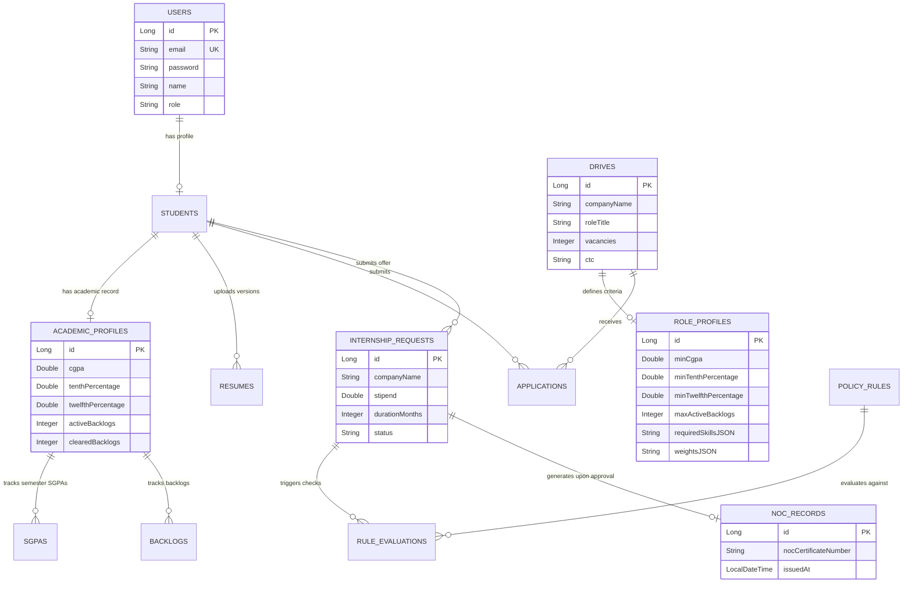

# PlacementOS — Complete System Masterguide & Technical Reference

**Project Title:** PlacementOS (Training & Placement Management System - TPMS & Internship Approval System)  
**Target Domain:** Campus Recruitment Automation, Algorithmic Candidate Matching, & Internship Governance (`@rknec.edu`)  
**Version:** 1.0.0  
**Generated Date:** August 25, 2026  

---

## 1. Executive Summary

**PlacementOS** is an enterprise-grade, dual-microservice web application designed to digitize, automate, and bring 100% transparency to university campus placement drives and off-campus internship approval workflows.

### 🎯 Core Problem Statement
Traditional university career centers and Training & Placement Offices (TPOs) suffer from major operational bottlenecks:
1. **Manual Excel Overhead**: TPOs spend hundreds of hours manually cross-referencing candidate resumes and spreadsheets against drive cutoffs.
2. **Opaque Selection & Favoured Shortlisting**: Students often lack visibility into why they were rejected, leading to claims of bias or nepotism.
3. **Late-Stage Cutoff Disqualifications**: Non-eligible candidates bypass manual screening and participate in campus drives only to be disqualified after final interview rounds.
4. **Unregulated Off-Campus Internships**: Students encounter fraudulent offer letters, below-stipend exploitation, or suspicious unverified organizations.

### 💡 The PlacementOS Solution
PlacementOS addresses these challenges through two decoupled microservices:
1. **TPMS (Training & Placement Management System)**: Integrates **Groq LLMs** (`llama-3.3-70b-versatile` / `compound-mini`) to extract structured job requirements and candidate profiles. Enforces **hard database-level academic eligibility guards**, scores eligible candidates with an extensible **Strategy-Pattern Candidate Scoring Engine**, and mandates **audit-logged justifications** for any TPO status overrides.
2. **Internship Approval System**: Automates digital **No Objection Certificate (NOC)** issuance by processing offer letters through a **Dynamic Policy Rule Engine** (verifying minimum stipends, durations, allowlists/denylists, and scam pattern indicators).

---

## 2. Core Architectural Mental Model

PlacementOS operates as a central operating system between **Students**, **Placement Officers (Coordinators/TPOs)**, and **Corporate Recruiters**.

```mermaid
flowchart TD
    subgraph Input Layer
        RawJD[Unstructured Job Description Text / Document]
        StudentResume[Student PDF Resume & Profile]
        OfferLetter[Off-Campus Internship Offer Letter PDF]
    end

    subgraph PlacementOS Microservice Architecture
        subgraph Microservice 1: TPMS (Port 8081 / 3000)
            RawJD -->|Groq LLM API| ExtractedJD[Structured Drive Criteria & JSON Taxonomy]
            StudentResume -->|Groq LLM API| ExtractedSkills[Extracted Candidate Skills & DSA Handles]
            
            ExtractedJD --> AcademicGuard{Academic Eligibility Engine}
            StudentProfile[Student Academic Record - CGPA, SGPA, Backlogs] --> AcademicGuard
            
            AcademicGuard -- Failing Criteria --> IneligibleBlock[400 Bad Request + Rejection Reason]
            AcademicGuard -- Passing Criteria --> ScoringEngine[Strategy-Pattern Composite Scoring Engine]
            ExtractedSkills --> ScoringEngine
            
            ScoringEngine --> ShortlistMatrix[Ranked Candidate Matrix 0-100]
            ShortlistMatrix --> OverrideAudit[Coordinator Override + Mandatory Audit Log]
        end

        subgraph Microservice 2: Internship Approval (Port 8082 / 3001)
            OfferLetter --> PolicyEngine{Dynamic Policy Evaluator Engine}
            PolicyEngine -->|Check| StipendRule[Min Stipend Evaluator]
            PolicyEngine -->|Check| DurationRule[Min Duration Evaluator]
            PolicyEngine -->|Check| DenylistRule[Company Allowlist / Denylist Evaluator]
            PolicyEngine -->|Check| ScamRule[Scam Pattern Flag Detector]
            
            StipendRule & DurationRule & DenylistRule & ScamRule --> CDPCQueue[CDPC Review Queue]
            CDPCQueue -->|Approved| DigitalNOC[Digital NOC Generation & Verification]
        end
    end
```

---

## 3. Deep-Dive Microservice Breakdown

### 3.1 Microservice 1: TPMS (`tpms/`)
* **Backend:** Spring Boot 3.x with Java 17 (Port `8081`, Context Path `/api`)
* **Frontend:** React 18 + Vite (Port `3000`)
* **Database:** MySQL (`tpms_db`)

#### Core Modules & Features:

1. **Domain Security & Access Control**:
   - Strictly enforces registration to campus email addresses ending in `@rknec.edu`.
   - Uses stateless **JWT tokens** carrying normalized user roles (`ROLE_STUDENT`, `ROLE_COORDINATOR`, `ROLE_ADMIN`).
   - Automatically bootstraps a default TPO coordinator account (`coord_user@rknec.edu`).

2. **AI Job Description (JD) & Resume Extraction Engine**:
   - **Groq Cloud LLM Integration**: Converts raw JD text or uploaded documents (`.pdf`, `.txt`, `.docx`) into a verified JSON structure:
     - **Skill Taxonomy**: Categorized into `MUST_HAVE`, `NICE_TO_HAVE`, and `BONUS`.
     - **Scoring Weights**: Customizable weights across `skillMatch`, `projectRelevance`, `codingActivity`, `certifications`, and `experience`.
     - **Academic Cutoffs**: Extracts `minCgpa`, `minTenthPercentage`, `minTwelfthPercentage`, and `maxActiveBacklogs`.
   - **Resume PDF Extraction**: Extracts student technical skills, DSA projects, coding platform handles (LeetCode, CodeChef, GitHub), and certifications.
   - **Offline Mock Fallback**: Includes a simulated mock extraction engine for zero downtime if external LLM APIs are offline or rate-limited.

3. **Deterministic Academic Eligibility Validation Guard**:
   - Executes at the DB layer inside `DriveService.applyToDrive(...)` before creating an application record.
   - Evaluates:
     $$\text{Student CGPA} \ge \text{Min CGPA}$$
     $$\text{10th Percentage} \ge \text{Min 10th \%}$$
     $$\text{12th Percentage} \ge \text{Min 12th \%}$$
     $$\text{Active Backlogs} \le \text{Max Active Backlogs}$$
   - Instantly blocks non-compliant applications with an explicit `400 Bad Request` message detailing the exact failing criterion (e.g., *"Ineligible: Student CGPA (7.20) is below drive requirement (7.50)"*).

4. **Strategy-Pattern Candidate Scoring & Shortlisting Engine**:
   - Implements the **Strategy Design Pattern** (`ScoringStrategy` interface) with concrete strategy implementations:
     - `SkillMatchScoringStrategy`: Computes Jaccard/weighted overlap of student skills against drive requirements.
     - `ProjectRelevanceScoringStrategy`: Evaluates project descriptions and technology tags.
     - `CodingActivityScoringStrategy`: Factors in LeetCode ratings, problem counts, and GitHub profile activity.
     - `CertificationsScoringStrategy`: Evaluates verified certifications.
     - `ExperienceScoringStrategy`: Scores internships or relevant work history.
   - Produces a composite candidate score from $0.0$ to $100.0$ and ranks candidates dynamically.

5. **Accountable Coordinator Override & Mandatory Audit Trail**:
   - Coordinators can override candidate status to `OVERRIDDEN_INCLUDED` or `OVERRIDDEN_EXCLUDED`.
   - The system **blocks** the override unless a non-empty written reason (e.g., *"Winner of Smart India Hackathon 2025"*) is provided, permanently attaching it to the application audit log.

6. **Administrative Maintenance & Database Purge**:
   - One-click DB cleanup endpoint (`POST /api/admin/data/cleanup`) allowing TPOs to purge student profiles, applications, and drive data while preserving foreign key integrity.

---

### 3.2 Microservice 2: Internship Approval System (`internship-approval/`)
* **Backend:** Spring Boot 3.x with Java 17 (Port `8082`, Context Path `/api`)
* **Frontend:** React 18 + Vite (Port `3001`)
* **Database:** MySQL (`internship_db`)

#### Core Modules & Features:

1. **Off-Campus Student Submissions**:
   - Students submit off-campus internship requests, specifying company details, stipend, duration (months), start/end dates, mode (`ON_SITE`, `REMOTE`, `HYBRID`), and offer letter documents.

2. **Dynamic Policy Rule Engine & Evaluators**:
   - Processes submissions through a chain of rule evaluators implementing `RuleEvaluator`:
     - `MinStipendRuleEvaluator`: Flags offers below institutional minimum stipend thresholds (e.g., `< ₹10,000/month`).
     - `MinDurationRuleEvaluator`: Flags offers failing minimum internship duration requirements.
     - `CompanyDenylistRuleEvaluator`: Automatically blocks blacklisted or flagged companies.
     - `CompanyAllowlistRuleEvaluator`: Expedites processing for trusted corporate partners.

3. **Scam Pattern & Fraud Detection**:
   - Scans offer letter text and company profiles for common scam indicators (e.g., requests for security deposits, unverified domain emails, generic job titles).

4. **CDPC Review Queue & Digital NOC Issuance**:
   - College Career Development & Placement Cell (CDPC) admins (`admin@rknec.edu`) review flagged submissions with automated policy violation badges.
   - Approved requests automatically issue a unique **Digital No Objection Certificate (NOC)** with verification metadata.

---

## 4. Tech Stack & Tooling Matrix

| Component Layer | Technology / Library | Version / Details | Purpose / Role |
| :--- | :--- | :--- | :--- |
| **JDK / Runtime** | Java OpenJDK | 17 | High-performance backend execution |
| **Backend Framework** | Spring Boot | 3.x | Microservice framework, REST APIs, JPA |
| **Security** | Spring Security + JWT | JJWT 0.11.5 | Stateless authentication & RBAC |
| **AI / LLM Infrastructure** | Groq Cloud API | `llama-3.3-70b-versatile` | JSON JD extraction & PDF resume parsing |
| **Database** | MySQL / Hibernate | 8.x / Spring Data JPA | Relational data storage & schema management |
| **Build Tool** | Apache Maven | 3.8+ | Dependency management & project build |
| **Frontend Framework** | React | 18.2.0 | Reactive component-driven UI |
| **Bundler & Dev Server** | Vite | 5.1.6 | Fast frontend development & build pipeline |
| **UI Components & Icons** | Lucide React | 0.344.0 | Modern SVG iconography |
| **Styling** | Vanilla CSS + HSL Design Tokens | CSS3 Custom Properties | Glassmorphic aesthetic, dark theme, responsive grid |

---

## 5. Database Schemas & Data Models

### 5.1 System ERD Diagram (Mermaid)



---

## 6. Main REST API Specification

### 6.1 TPMS API Endpoints (`http://localhost:8081/api`)

| HTTP Method | Endpoint Path | Role Required | Description |
| :--- | :--- | :--- | :--- |
| `POST` | `/auth/register` | Public | Register user with `@rknec.edu` email |
| `POST` | `/auth/login` | Public | Authenticate user & return JWT token |
| `GET` | `/students/{id}/profile` | Student / Staff | Retrieve complete student profile |
| `PUT` | `/students/{id}/profile` | Student | Update academic percentages & backlogs |
| `POST` | `/resumes/upload` | Student | Upload resume PDF for LLM extraction |
| `GET` | `/drives` | Authenticated | Fetch all placement drives |
| `POST` | `/drives/extract-jd` | Staff (`COORDINATOR`/`ADMIN`) | Send raw JD text/file to Groq LLM |
| `POST` | `/drives` | Staff (`COORDINATOR`/`ADMIN`) | Create & publish placement drive |
| `DELETE` | `/drives/{id}` | Staff (`COORDINATOR`/`ADMIN`) | Delete placement drive & applications |
| `POST` | `/drives/{id}/apply` | Student | Apply to drive (**triggers eligibility guard**) |
| `POST` | `/drives/{id}/rank` | Staff (`COORDINATOR`/`ADMIN`) | Run candidate scoring & generate rank matrix |
| `POST` | `/applications/{id}/override` | Staff (`COORDINATOR`/`ADMIN`) | Override candidate status with mandatory reason |
| `POST` | `/admin/data/cleanup` | Staff (`ADMIN`/`COORDINATOR`) | Execute database purge |

### 6.2 Internship Approval API Endpoints (`http://localhost:8082/api`)

| HTTP Method | Endpoint Path | Role Required | Description |
| :--- | :--- | :--- | :--- |
| `POST` | `/auth/register` | Public | Register user for internship portal |
| `POST` | `/auth/login` | Public | Authenticate user & return JWT token |
| `POST` | `/internships/submit` | Student | Submit off-campus offer letter & details |
| `GET` | `/internships/my-submissions` | Student | Track submitted internship NOC requests |
| `GET` | `/cdpc/submissions` | Staff (`ADMIN`/`CDPC`) | View all pending/flagged submissions in CDPC queue |
| `POST` | `/cdpc/submissions/{id}/approve` | Staff (`ADMIN`/`CDPC`) | Approve submission & issue Digital NOC |
| `POST` | `/cdpc/submissions/{id}/reject` | Staff (`ADMIN`/`CDPC`) | Reject submission with policy explanation |
| `GET` | `/cdpc/rules` | Staff (`ADMIN`/`CDPC`) | List active policy rules & stipend thresholds |
| `POST` | `/cdpc/rules` | Staff (`ADMIN`/`CDPC`) | Create or update dynamic policy rules |

---

## 7. Frontend Component Architecture

### 7.1 TPMS Frontend (`tpms/frontend/src/`)
- `App.jsx`: Main navigation shell, state management, placement drive cards, drive creation trigger, DB purge trigger.
- `components/Navbar.jsx`: Top navigation header with role awareness (`isStaff`, `isStudent`), tab routing, and purge modal controls.
- `components/CreateDriveView.jsx`: 3-step wizard for drive setup:
  - Step 1: Basic Drive Information (Company, Role, Vacancies, CTC).
  - Step 2: Unstructured JD Extractor (Text area or File Upload).
  - Step 3: Interactive Skill Taxonomy & Cutoff Preview Grid.
- `components/StudentApplicationsView.jsx`: Student view displaying available drives, eligibility badges (`CGPA ≥ X`, `Backlogs ≤ Y`), application status, and real-time rejection feedback.
- `components/RankedShortlistView.jsx`: Coordinator view presenting candidate rank matrix (0-100 score), component sub-scores, candidate status override modal, and audit logs.
- `components/AcademicSetupView.jsx`: Student profile setup form for recording CGPA, semester SGPAs, 10th/12th percentages, and backlogs.
- `components/ResumeUploadView.jsx`: Student PDF resume uploader displaying extracted LLM skills, DSA projects, and coding handles.

### 7.2 Internship Approval Frontend (`internship-approval/frontend/src/`)
- `App.jsx`: Main portal routing between Student Submissions and CDPC Admin Queue.
- `components/StudentSubmissionView.jsx`: Student form for entering offer letter details, stipend, duration, and uploading PDFs.
- `components/CdpcReviewQueueView.jsx`: CDPC Admin queue displaying submitted offers, policy violation warning badges, and NOC approval triggers.
- `components/CdpcPolicyRulesView.jsx`: Admin dashboard for configuring minimum stipend floors, duration rules, and company denylists.

---

## 8. Installation & Setup Guide

### 8.1 Prerequisites
- **Java OpenJDK 17** installed and configured in `PATH`.
- **Node.js v18+** and `npm` installed.
- **MySQL Server** running locally on port `3306`.
- **Groq API Key** (Optional - if omitted, systems operate in built-in mock mode).

### 8.2 Database Setup
Create MySQL databases (or let Spring Boot auto-create them via `createDatabaseIfNotExist=true`):
```sql
CREATE DATABASE IF NOT EXISTS tpms_db;
CREATE DATABASE IF NOT EXISTS internship_db;
```

### 8.3 Running TPMS Microservice
```bash
# 1. Start TPMS Backend (Port 8081)
cd PlacementOS/tpms/backend
mvn clean spring-boot:run

# 2. Start TPMS Frontend (Port 3000)
cd PlacementOS/tpms/frontend
npm install
npm run dev
```

### 8.4 Running Internship Approval Microservice
```bash
# 1. Start Internship Approval Backend (Port 8082)
cd PlacementOS/internship-approval/backend
mvn clean spring-boot:run

# 2. Start Internship Approval Frontend (Port 3001)
cd PlacementOS/internship-approval/frontend
npm install
npm run dev
```

### 8.5 Seed Accounts & Test Credentials
- **TPMS Coordinator Account**: `coord_user@rknec.edu` / `Coord@12345`
- **Internship CDPC Admin Account**: `admin@rknec.edu` / `Admin@12345`
- **Student Registration**: Any email ending with `@rknec.edu` (e.g., `student1@rknec.edu` / `Student@12345`).

---

## 9. End-to-End Testing & Verification Scenarios

### 🧪 Scenario A: AI Drive Creation & Requirements Extraction
1. Log in to TPMS (`http://localhost:3000`) as TPO (`coord_user@rknec.edu` / `Coord@12345`).
2. Click **Create Drive & Extract JD**.
3. Enter Company: `Google India`, Role: `Software Engineer`, CTC: `24 LPA`.
4. Paste raw text containing: *"We need Java and Spring Boot experts. Minimum CGPA 8.00, 75% in 10th and 12th, zero active backlogs."*
5. Click **Extract Criteria via AI**. Verify skills and cutoffs auto-populate correctly. Click **Publish Drive**.

### 🧪 Scenario B: Academic Eligibility Blocking
1. Log in as Student (`student_test@rknec.edu`).
2. Set student CGPA to `7.50` in **Academic Setup**.
3. Attempt to apply to the `Google India` drive (requires `8.00 CGPA`).
4. **Expected Result**: Application is blocked with an alert: `Ineligible: Student CGPA (7.50) is below requirement (8.00)`.

### 🧪 Scenario C: Candidate Ranking & Audit Override
1. Log in as TPO. Select `Google India` drive.
2. Click **Run Candidate Scoring & Rank Matrix**.
3. Inspect candidate scores ($0.0 - 100.0$) and shortlist matrix.
4. Click **Override Status** on candidate #2. Select `OVERRIDDEN_INCLUDED`.
5. System prompts for mandatory written reason: Type *"Smart India Hackathon Winner 2025"*.
6. Submit and verify the audit tag is saved.

### 🧪 Scenario D: Internship Offer Verification & Policy Violation
1. Log in to Internship Approval (`http://localhost:3001`) as Student.
2. Submit an offer letter with Stipend: `₹4,000/month`, Duration: `1 month`.
3. Log in as CDPC Admin (`admin@rknec.edu`).
4. **Expected Result**: Submission appears in CDPC Queue with warning badges: `Flagged: Below Min Stipend (₹10,000)` and `Flagged: Short Duration`.

---

## 10. Future Roadmap (Phase 6+)

1. **Executive Placement Analytics Dashboard**: Visual analytics tracking departmental placement rates, salary distributions, and recruiter trends over time.
2. **Automated Interview Slot Scheduling**: Self-service slot booking for shortlisted candidates with calendar sync and conflict resolution.
3. **Multi-Channel Alert Gateway**: Real-time Email & WhatsApp notification pipeline for drive updates, shortlist announcements, and NOC generation.
4. **Containerization & Deployment**: Multi-stage Dockerfiles and Kubernetes deployment manifests for scalable enterprise cloud hosting.

---
*PlacementOS — Empowering University Recruitment with Transparency, AI Precision, & Governance.*
