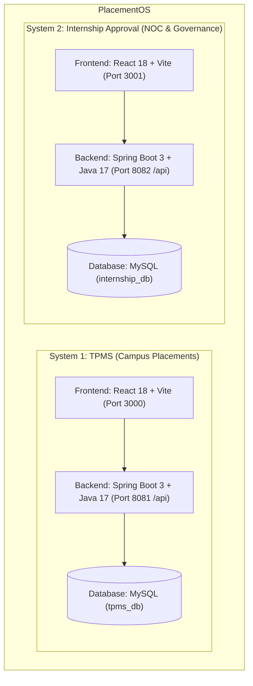

# PlacementOS

**PlacementOS** is an enterprise-grade, dual-microservice campus recruitment automation and internship governance platform engineered for university career centers and Training & Placement Offices (TPOs). The platform enforces institutional email identity (`@rknec.edu`), automates resume and job description criteria extraction using **Groq LLMs**, enforces deterministic academic eligibility cutoffs at the database layer, dynamically ranks candidates using a **Strategy-Pattern Candidate Scoring Engine**, and provides multi-signal fraud/scam detection for off-campus internship approvals.

---

## 🏛️ Architecture & System Modules

PlacementOS is composed of two independently deployable, decoupled microservices, each with its own dedicated backend, frontend, and database:



### Module 1: TPMS (Training & Placement Management System)
* **Backend:** Spring Boot 3.x, Java 17 (Port `8081`, API Base `/api`)
* **Frontend:** React 18, Vite, Tailwind CSS (Port `3000`)
* **Database:** MySQL (`tpms_db`)
* **Key Features:**
  * **Domain Access Control:** JWT stateless authentication restricted strictly to `@rknec.edu` campus emails.
  * **AI Job Description Extraction:** Uses Groq Cloud LLM (`groq/compound-mini` or `llama-3.3-70b-versatile`) to extract 3-tier skill taxonomies (`MUST_HAVE`, `NICE_TO_HAVE`, `BONUS`), category weights, and cutoffs.
  * **3-Step Drive Creation Wizard:** Coordinators review, refine, and publish extracted criteria.
  * **Deterministic Academic Eligibility Guard:** Hard pre-application validation evaluating CGPA, 10th marks %, 12th marks %, and active backlogs. Ineligible applicants are rejected immediately with HTTP `400 Bad Request`.
  * **Strategy-Pattern Candidate Scoring (0–100):** Multi-dimensional fit scoring across skill match, project relevance, coding activity (LeetCode/GitHub), certifications, and experience.
  * **Accountable Status Overrides:** Coordinators can force-include or force-exclude applicants, requiring a non-empty written justification logged in the permanent audit trail.
  * **Deterministic Rejection Feedback:** Explains selection/rejection rationale, lists missing skills, and provides a customized growth roadmap for students.
  * **Administrative Data Purge:** One-click database cleanup endpoint (`POST /api/admin/data/cleanup`) safely clearing student records and drives while preserving coordinator accounts.

### Module 2: Internship Approval System
* **Backend:** Spring Boot 3.x, Java 17 (Port `8082`, API Base `/api`)
* **Frontend:** React 18, Vite, Tailwind CSS (Port `3001`)
* **Database:** MySQL (`internship_db`)
* **Key Features:**
  * **Offer Letter Submissions:** Students submit internship offer details and PDF attachments with automatic SHA-256 duplicate file hashing.
  * **Dynamic Policy Rule Engine:** Evaluates offers against configurable institutional policies (minimum stipend, minimum duration, company denylists, trusted company allowlists).
  * **Multi-Signal Scam Pattern Detector:** Flags suspicious offers across 4 vectors:
    1. HR contact emails using public/free domains (`gmail.com`, `yahoo.com`, etc.).
    2. High-velocity offer submissions for the same company across distinct students within 60 days.
    3. Duplicate HR contact emails submitted by different students.
    4. Duplicate offer letter PDF SHA-256 hash collisions.
  * **CDPC Review Queue:** Institutional placement cell administrators audit flagged submissions and execute approvals or rejections.
  * **Digital NOC Generation:** Generates official, formatted university No Objection Certificate (NOC) PDFs on approval using Apache PDFBox.

---

## 📋 Prerequisites

Before running PlacementOS locally, ensure the following are installed:

| Tool | Minimum Version | Verification Command |
| :--- | :--- | :--- |
| **Java OpenJDK** | 17 LTS | `java -version` |
| **Apache Maven** | 3.8+ | `mvn -v` |
| **Node.js** | 18+ (LTS) | `node -v` |
| **npm** | 9+ | `npm -v` |
| **MySQL Server** | 8.x | `mysql --version` |

---

## ⚙️ Environment Variables & Configuration

Both modules use environment variables for sensitive settings. Example templates are provided in `.env.example` in each module directory:
* `tpms/.env.example`
* `internship-approval/.env.example`

### Required Variables (PowerShell)

Set these variables in your terminal before running the backends:

```powershell
# Relational Database Credentials
$env:SPRING_DATASOURCE_USERNAME="root"
$env:SPRING_DATASOURCE_PASSWORD="<your_local_mysql_password>"

# JWT Secret Key (Requires a secure 256-bit / 32-byte hex string)
# Generate with: openssl rand -hex 32
$env:JWT_SECRET="<your_32_byte_jwt_secret_hex>"

# Groq LLM API Key (Optional: if empty or unset, system operates in offline mock mode)
$env:GROQ_API_KEY="<your_groq_api_key_or_leave_empty_for_mock_mode>"

# Optional Bootstrap Account Overrides
$env:BOOTSTRAP_COORDINATOR_EMAIL="coord_user@rknec.edu"
$env:BOOTSTRAP_COORDINATOR_PASSWORD="Coord@12345"
$env:BOOTSTRAP_ADMIN_EMAIL="admin@rknec.edu"
$env:BOOTSTRAP_ADMIN_PASSWORD="Admin@12345"

# NOC Verification HMAC Secret (Required outside demo profile, min 32 chars)
$env:NOC_VERIFICATION_SECRET="<generate-with-openssl-rand-hex-32>"

# Optional Email Notification Configuration (MailHog)
$env:NOTIFICATIONS_ENABLED="false"
$env:MAIL_HOST="localhost"
$env:MAIL_PORT="1025"
```

### Required Variables (Bash / Linux / macOS)

```bash
export SPRING_DATASOURCE_USERNAME="root"
export SPRING_DATASOURCE_PASSWORD="<your_local_mysql_password>"
export JWT_SECRET="$(openssl rand -hex 32)"
export GROQ_API_KEY="<your_groq_api_key_or_leave_empty_for_mock_mode>"
export BOOTSTRAP_COORDINATOR_EMAIL="coord_user@rknec.edu"
export BOOTSTRAP_COORDINATOR_PASSWORD="Coord@12345"
export BOOTSTRAP_ADMIN_EMAIL="admin@rknec.edu"
export BOOTSTRAP_ADMIN_PASSWORD="Admin@12345"
export NOC_VERIFICATION_SECRET="$(openssl rand -hex 32)"
export NOTIFICATIONS_ENABLED="false"
export MAIL_HOST="localhost"
export MAIL_PORT="1025"
```

---

## 🗄️ Database Setup

Ensure your local MySQL service is running on `localhost:3306`. Create the two independent databases:

```sql
CREATE DATABASE IF NOT EXISTS tpms_db CHARACTER SET utf8mb4 COLLATE utf8mb4_unicode_ci;
CREATE DATABASE IF NOT EXISTS internship_db CHARACTER SET utf8mb4 COLLATE utf8mb4_unicode_ci;
```

*(Note: If `createDatabaseIfNotExist=true` is enabled in the JDBC connection strings, Spring Boot will attempt to auto-create them on first startup).*

---

## 🚀 Running the Applications Locally (Zero-Setup Demo Profile Active by Default)

PlacementOS backends enable the **`demo` profile by default** (`spring.profiles.default: demo`). This seeds all prototype demo accounts and verified academic profiles on first boot without any manual registration or setup.

### Quick Start (All Services in 1 Click):
```powershell
.\start-all.bat
# or in PowerShell:
.\start-all.ps1
```

Or start microservices individually:

### Terminal 1: TPMS Backend (Port 8081)
```powershell
cd tpms\backend
.\mvnw.cmd spring-boot:run
```
*Health Check:* `http://localhost:8081/api/drives`

### Terminal 2: Internship Approval Backend (Port 8082)
```powershell
cd internship-approval\backend
.\mvnw.cmd spring-boot:run
```
*Health Check:* `http://localhost:8082/api/internships`

### Terminal 3: TPMS Frontend (Port 3000)
```powershell
cd tpms\frontend
npm install
npm run dev
```
*Access in Browser:* `http://localhost:3000`

### Terminal 4: Internship Approval Frontend (Port 3001)
```powershell
cd internship-approval\frontend
npm install
npm run dev
```
*Access in Browser:* `http://localhost:3001`

### Optional: Local Email Testing with MailHog

Both microservices support asynchronous transactional email notifications. By default, `NOTIFICATIONS_ENABLED=false` so the applications boot cleanly with zero mail setup.

To test emails locally with MailHog:

1. **Start MailHog via Docker:**
   ```powershell
   docker run -d -p 1025:1025 -p 8025:8025 --name mailhog mailhog/mailhog
   ```
   *(Or download the standalone binary for Windows from [MailHog Releases](https://github.com/mailhog/MailHog/releases) and execute `MailHog_windows_amd64.exe`)*.

2. **Access MailHog Web Inbox:**
   Open `http://localhost:8025` in your browser.

3. **Enable Notifications in Backends:**
   Set the environment variable before starting the backends:
   ```powershell
   $env:NOTIFICATIONS_ENABLED="true"
   ```
   SMTP messages will be delivered to `localhost:1025` and viewable in the MailHog web UI, with audit records persisted to the `notification_logs` table (no bodies stored).

---

## 👤 1-Click Quick-Login Demo Accounts

Both frontends provide instant 1-click login buttons powered by the backend `demo` profile:

| App | UI Quick-Login Button | Email | Role | Verification Status |
| :--- | :--- | :--- | :--- | :--- |
| **TPMS** | `Student Candidate` | `candidate.student@rknec.edu` | `STUDENT` | Verified (8.5 CGPA, 0 backlogs, CSE) |
| **TPMS** | `TPO / Coordinator` | `admin@rknec.edu` | `ADMIN` | Staff Admin Privileges |
| **TPMS** | Testing / Manual | `student1@rknec.edu` | `STUDENT` | Verified (8.5 CGPA, 0 backlogs, CSE) |
| **TPMS** | Testing / Manual | `coord_user@rknec.edu` | `COORDINATOR` | Placement Coordinator |
| **Internship** | `Rahul Sharma (Student)` | `student1@rknec.edu` | `STUDENT` | Student Submissions & NOC Access |
| **Internship** | `CDPC Admin` | `admin@rknec.edu` | `CDPC_ADMIN` | Review Queue & Policy Rule Customization |

> **Preservation Guarantee**: See [`docs/PRESERVATION_CONTRACT.md`](docs/PRESERVATION_CONTRACT.md) for immutable login and demo account preservation rules.
> To verify that all demo logins and backend endpoints remain functional after any change, run:
> ```powershell
> powershell -ExecutionPolicy Bypass -File scripts/preservation-check.ps1
> ```

> **Domain Restriction:** All user registration and login endpoints enforce the `@rknec.edu` domain. Non-campus email addresses are rejected with `400 Bad Request`.

---

## 🧪 Running Tests & Production Builds

### Automated Backend Test Suites (JUnit 5 + Mockito)

```powershell
# Run TPMS backend tests (21 tests)
cd c:\Users\Lenovo\Downloads\PlacementOS\tpms\backend
mvn test

# Run Internship Approval backend tests (20 tests)
cd c:\Users\Lenovo\Downloads\PlacementOS\internship-approval\backend
mvn test
```

### Production Frontend Builds (Vite)

```powershell
# Build TPMS frontend
cd c:\Users\Lenovo\Downloads\PlacementOS\tpms\frontend
npm run build

# Build Internship Approval frontend
cd c:\Users\Lenovo\Downloads\PlacementOS\internship-approval\frontend
npm run build
```

---

## 📚 Documentation & Reference Guides

Comprehensive documentation and testing guides are available across the repository:

* 📖 **[TESTING_GUIDE.md](file:///c:/Users/Lenovo/Downloads/PlacementOS/TESTING_GUIDE.md)**: Comprehensive manual testing walkthrough and cURL API testing reference.
* ⚡ **[QUICK_TEST_CHEATSHEET.md](file:///c:/Users/Lenovo/Downloads/PlacementOS/QUICK_TEST_CHEATSHEET.md)**: Copy-paste sample job descriptions, test credentials, and form inputs.
* 📘 **[PROJECT_EXPLANATION.md](file:///c:/Users/Lenovo/Downloads/PlacementOS/PROJECT_EXPLANATION.md)**: Complete system masterguide, architectural mental models, and deep-dive microservice breakdown.
* 📊 **[PROJECT_DOCUMENTATION_REPORT.md](file:///c:/Users/Lenovo/Downloads/PlacementOS/PROJECT_DOCUMENTATION_REPORT.md)**: Technical architecture report, database ERD schema, and endpoint inventory.
* 📅 **[PROJECT_DEVELOPMENT_TIMELINE.md](file:///c:/Users/Lenovo/Downloads/PlacementOS/PROJECT_DEVELOPMENT_TIMELINE.md)**: Week-by-week sprint timeline, Mermaid Gantt chart, and presentation slides.
* 🎯 **[PLACEMENTOS_PITCH_AND_UNDERSTANDING_REPORT.md](file:///c:/Users/Lenovo/Downloads/PlacementOS/PLACEMENTOS_PITCH_AND_UNDERSTANDING_REPORT.md)**: Executive elevator pitches, 4-act live demo script, and stakeholder defense Q&A.
* 🔍 **[PLACEMENTOS_COMPREHENSIVE_AUDIT_REPORT.md](file:///c:/Users/Lenovo/Downloads/PlacementOS/PLACEMENTOS_COMPREHENSIVE_AUDIT_REPORT.md)**: Verification audit report covering ideation evolution, built proof, and prioritized remaining backlog.
