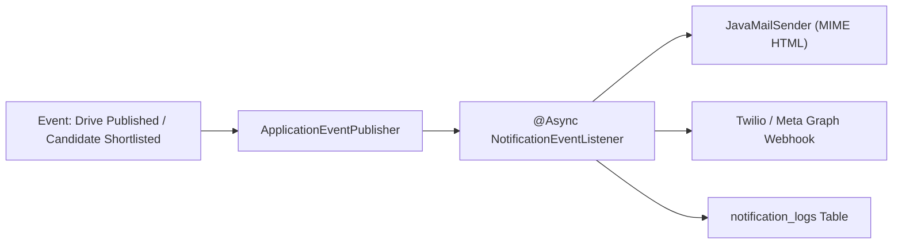
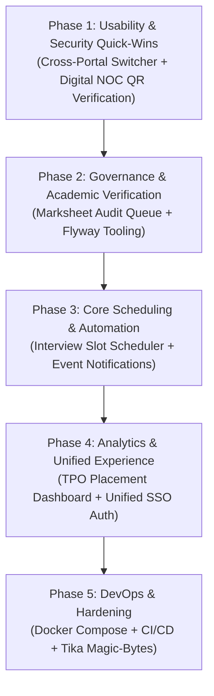

# PlacementOS — Master Engineering Roadmap & Implementation Specification
## Complete Inventory of Pending Features, Technical Debt & Architectural Enhancements

**Document Version:** 2.0.0  
**Status:** Living Engineering Blueprint  
**Target Architecture:** Dual Microservices (`tpms` on Port 8081/3000 & `internship-approval` on Port 8082/3001)  
**Active Baseline:** Spring Boot 3.2.2, Java 17, React 18, Vite 5, MySQL 8.x, Apache PDFBox 2.0.29  

---

## Table of Contents
1. [Executive Summary & High-Level Task Matrix](#1-executive-summary--high-level-task-matrix)
2. [Task 1: Cross-Portal Navigation & Header Switcher](#task-1-cross-portal-navigation--header-switcher)
3. [Task 2: Digital NOC QR Code Verification Engine (Internship Service)](#task-2-digital-noc-qr-code-verification-engine-internship-service)
4. [Task 3: Cross-Service Single Sign-On (SSO) & Unified Identity](#task-3-cross-service-single-sign-on-sso--unified-identity)
5. [Task 4: TPO Executive Placement Analytics & Reporting Dashboard](#task-4-tpo-executive-placement-analytics--reporting-dashboard)
6. [Task 5: Automated Interview Slot Booking Engine (Concurrency-Guarded)](#task-5-automated-interview-slot-booking-engine-concurrency-guarded)
7. [Task 6: Multi-Channel Notification Gateway (Email & WhatsApp)](#task-6-multi-channel-notification-gateway-email--whatsapp)
8. [Task 7: Academic Credential & Marksheet Verification Audit Queue](#task-7-academic-credential--marksheet-verification-audit-queue)
9. [Task 8: Production Dockerization & Docker Compose Orchestration](#task-8-production-dockerization--docker-compose-orchestration)
10. [Task 9: Flyway Database Migration Tooling Integration](#task-9-flyway-database-migration-tooling-integration)
11. [Task 10: Automated CI/CD Pipeline (GitHub Actions)](#task-10-automated-cicd-pipeline-github-actions)
12. [Task 11: Enterprise Security Hardening (Tokens, Magic-Bytes, Rate Limits)](#task-11-enterprise-security-hardening-tokens-magic-bytes-rate-limits)
13. [Phased Implementation Roadmap & Verification Order](#13-phased-implementation-roadmap--verification-order)

---

## 1. Executive Summary & High-Level Task Matrix

PlacementOS is structured as a dual-microservice platform. The table below represents the **exhaustive list of all engineering work** that remains to be built, ordered by implementation dependency:

| # | Feature / Work Item | Subsystem | Complexity | Files to Touch / Create |
|---|---|---|:---:|---|
| **1** | **Cross-Portal Switcher** | Both Frontends | Low | `tpms/frontend/src/components/Navbar.jsx`<br>`internship-approval/frontend/src/components/Header.jsx` |
| **2** | **Digital NOC QR Verification** | Internship (BE + FE) | Medium | `NocPdfGeneratorService.java`, `PublicVerificationController.java`, `V2__add_noc_verification.sql`, `VerifyNocPage.jsx` |
| **3** | **Unified SSO & Shared Auth** | Both Services | High | `JwtUtils.java`, `SecurityConfig.java`, Auth controllers, shared cookie |
| **4** | **TPO Placement Analytics** | TPMS (BE + FE) | High | `AnalyticsController.java`, `AnalyticsService.java`, `TpoAnalyticsDashboard.jsx`, `recharts` |
| **5** | **Interview Slot Scheduler** | TPMS (BE + FE) | High | `InterviewRound.java`, `InterviewSlot.java`, `InterviewSlotService.java` (Pessimistic Locking), `InterviewSchedulerModal.jsx` |
| **6** | **Notification Gateway** | Both Services | Medium | `NotificationEventListener.java`, `JavaMailSender`, `notification_logs`, HTML templates |
| **7** | **Marksheet Audit Queue** | TPMS (BE + FE) | Medium | `AcademicProfile.java`, `DriveService.java` (Hard Guard), `AcademicAuditQueue.jsx` |
| **8** | **Docker Compose Setup** | DevOps / Root | Medium | `tpms/backend/Dockerfile`, `internship/backend/Dockerfile`, `tpms/frontend/Dockerfile`, `docker-compose.yml` |
| **9** | **Flyway Integration** | Both Backends | Low | `pom.xml` (`flyway-core`, `flyway-mysql`), `application.yml` (`ddl-auto: validate`) |
| **10**| **GitHub Actions CI/CD** | DevOps / Root | Low | `.github/workflows/ci.yml` |
| **11**| **Security & Token Hardening** | Both Backends | Medium | Refresh tokens, Apache Tika magic-byte PDF validation, IP-level rate limiting |

---

## Task 1: Cross-Portal Navigation & Header Switcher

### 1.1 Objective & Problem
Users currently open `http://localhost:3000` (TPMS) and do not see the Internship Approval module because it runs as a separate portal on `http://localhost:3001`. There are zero navigation links connecting the two applications.

### 1.2 Implementation Details
1. **TPMS Frontend (`tpms/frontend/src/components/Navbar.jsx`):**
   - Add a direct external navigation pill in the header:
     ```jsx
     <a
       href="http://localhost:3001"
       target="_blank"
       rel="noopener noreferrer"
       className="px-3 py-1.5 rounded-lg text-xs font-semibold bg-emerald-50 text-emerald-800 border border-emerald-200 hover:bg-emerald-100 flex items-center space-x-1 transition-all"
     >
       <span>Internship Portal (NOC)</span>
       <ExternalLink className="w-3.5 h-3.5 text-emerald-600" />
     </a>
     ```
2. **Internship Frontend (`internship-approval/frontend/src/components/Header.jsx`):**
   - Add a matching return button:
     ```jsx
     <a
       href="http://localhost:3000"
       target="_blank"
       rel="noopener noreferrer"
       className="px-3 py-1.5 rounded-lg text-xs font-semibold bg-teal-50 text-teal-800 border border-teal-200 hover:bg-teal-100 flex items-center space-x-1 transition-all"
     >
       <span>Campus Placements (TPMS)</span>
       <ExternalLink className="w-3.5 h-3.5 text-teal-600" />
     </a>
     ```

---

## Task 2: Digital NOC QR Code Verification Engine (Internship Service)

### 2.1 Objective & Problem
When students present an approved university No Objection Certificate (NOC) PDF to employer HRs, there is no cryptographic or automated mechanism for employers to verify its authenticity.

### 2.2 Detailed Specifications
1. **Flyway Migration (`internship-approval/backend/src/main/resources/db/migration/V2__add_noc_verification.sql`):**
   - Add `verification_token` (`VARCHAR(64)`, `NULLABLE`, unique index).
   - Add `qr_generated_at` (`DATETIME`).
   - Safe startup backfill: Generate HMAC tokens for pre-existing approved rows where `verification_token IS NULL`.
2. **Cryptographic Token Generator:**
   - Compute `HMAC-SHA256` over: `requestId + ":" + studentEmail + ":" + companyName + ":" + issuedTimestamp`.
   - Keyed by a dedicated environment variable: `NOC_VERIFICATION_SECRET`.
   - **Fail-Fast Validation:** Fail application startup immediately if `NOC_VERIFICATION_SECRET` is missing or shorter than 32 characters (identical to `JWT_SECRET` check).
   - Store as a 32-character lowercase hexadecimal string.
3. **QR Generation & PDFBox Injection:**
   - Add `com.google.zxing:javase:3.5.3`.
   - Encode URL: `${app.verification.base-url:http://localhost:3001/verify-noc}?token=<token>`.
   - Embed QR code at bottom-right corner of the NOC PDF using Apache PDFBox (`PDImageXObject`).
   - **Critical Rule:** Explicitly invoke `contentStream.setFont(...)` before any `contentStream.showText(...)`.
   - Add unit test to verify that the generated PDF contains the QR image and decodes back to the exact URL.
4. **Public Verification Endpoint:**
   - `GET /api/public/noc/verify/{token}`
   - Configure `SecurityConfig` to `permitAll` exclusively for `/public/**`.
   - **Masking Constraint:** For valid tokens, return masked student name (e.g., `"R**** S*****"`), company name, role, and approval date. **Never return** college ID, student email, or staff approver details.
   - For unknown/tampered tokens, return `valid: false` with the exact same response shape (zero hints for attackers).
   - In-memory IP rate limiter: Allow max 10 verification requests per minute per IP.
5. **Public Frontend View (`internship-approval/frontend/src/components/VerifyNocPage.jsx`):**
   - Route: `/verify-noc` (accessible without authentication).
   - Parses `?token=<hex>`.
   - Renders a green verified banner with university seal or a red "Cannot Be Verified" alert.

---

## Task 3: Cross-Service Single Sign-On (SSO) & Unified Identity

### 3.1 Objective & Problem
Currently, `tpms_db.users` and `internship_db.users` are separate. A student registered in TPMS cannot log into Internship Approval without registering a second time in the second application.

### 3.2 Implementation Architecture
1. **Shared Asymmetric Signing Key (RSA256) or Shared Secret:**
   - Align both services to accept tokens signed with the same root institutional secret.
2. **Unified Cross-Service Claims Payload:**
   ```json
   {
     "sub": "student1@rknec.edu",
     "userId": 101,
     "collegeId": "STU001",
     "name": "Rahul Sharma",
     "roles": {
       "tpms": "STUDENT",
       "internship": "STUDENT"
     },
     "iss": "placementos-auth",
     "exp": 1735689600
   }
   ```
3. **Automatic User Provisioning (JIT - Just-In-Time):**
   - If a valid token issued by TPMS hits `internship-approval` for the first time, an `AuthenticationSuccessHandler` or filter automatically provisions a corresponding student record in `internship_db.users` without throwing 401.

---

## Task 4: TPO Executive Placement Analytics & Reporting Dashboard

### 4.1 Objective & Problem
University Deans, HODs, and Placement Coordinators lack high-level visibility into institutional metrics. Generating accreditation reports (NIRF Metric 5.2.1, NAAC Criterion V) currently requires manual spreadsheet collation.

### 4.2 Database Indexes & Aggregations (`tpms_db`)
```sql
CREATE INDEX idx_academic_branch_grad ON academic_profiles (branch, expected_graduation_year);
CREATE INDEX idx_applications_drive_status ON applications (drive_id, status);
CREATE INDEX idx_students_placement_status ON students (placement_status);
CREATE INDEX idx_drives_created_at ON drives (created_at);
```

### 4.3 Backend Components (`tpms/backend`)
- **`AnalyticsController.java`:**
  - `GET /api/admin/analytics/overview` (Macro stats, overall %, average/median CTC).
  - `GET /api/admin/analytics/branch-distribution` (Department-wise breakdown).
  - `GET /api/admin/analytics/ctc-distribution` (Histogram tiers: < 5 LPA, 5–10 LPA, 10–20 LPA, > 20 LPA).
  - `GET /api/admin/analytics/export/nirf?year=2026` (Streams formatted CSV/Excel).
- **`AnalyticsService.java`:**
  - Implements median CTC calculation using mathematical percentile interpolation.
  - Generates recruitment funnel data: Registered $\rightarrow$ Applications $\rightarrow$ Shortlisted $\rightarrow$ Placed.

### 4.4 Frontend Dashboard (`tpms/frontend`)
- **Package:** `recharts`
- **Component:** `src/components/TpoAnalyticsDashboard.jsx`:
  - 4 KPI cards: Total Placed, Overall Placement %, Average CTC (LPA), Highest Package (LPA).
  - Responsive Bar Chart comparing departmental placement percentages.
  - Donut Chart showing tier-wise salary distributions.
  - Funnel Chart depicting candidate conversion.
  - One-click CSV Export button for NAAC/NIRF audits.

---

## Task 5: Automated Interview Slot Booking Engine (Concurrency-Guarded)

### 5.1 Objective & Problem
Manual scheduling of shortlisted candidates creates coordination chaos and double-booking risks. Students need a self-service calendar to pick interview slots with deterministic concurrency protection.

### 5.2 Database Schema (`tpms_db`)
```sql
CREATE TABLE interview_rounds (
    id BIGINT AUTO_INCREMENT PRIMARY KEY,
    drive_id BIGINT NOT NULL,
    round_name VARCHAR(100) NOT NULL, -- "Technical Round 1", "HR Round"
    round_order INT NOT NULL DEFAULT 1,
    duration_minutes INT NOT NULL DEFAULT 30,
    created_at DATETIME(6) NOT NULL,
    CONSTRAINT fk_round_drive FOREIGN KEY (drive_id) REFERENCES drives(id) ON DELETE CASCADE
);

CREATE TABLE interview_slots (
    id BIGINT AUTO_INCREMENT PRIMARY KEY,
    round_id BIGINT NOT NULL,
    start_time DATETIME NOT NULL,
    end_time DATETIME NOT NULL,
    capacity INT NOT NULL DEFAULT 1,
    booked_count INT NOT NULL DEFAULT 0,
    room_or_link VARCHAR(500),
    interviewer_name VARCHAR(255),
    CONSTRAINT fk_slot_round FOREIGN KEY (round_id) REFERENCES interview_rounds(id) ON DELETE CASCADE,
    INDEX idx_slot_round_time (round_id, start_time)
);

CREATE TABLE candidate_slot_bookings (
    id BIGINT AUTO_INCREMENT PRIMARY KEY,
    slot_id BIGINT NOT NULL,
    student_id BIGINT NOT NULL,
    application_id BIGINT NOT NULL,
    status ENUM('CONFIRMED', 'CANCELLED', 'ATTENDED', 'ABSENT') NOT NULL DEFAULT 'CONFIRMED',
    booked_at DATETIME(6) NOT NULL,
    feedback_notes TEXT,
    CONSTRAINT fk_booking_slot FOREIGN KEY (slot_id) REFERENCES interview_slots(id) ON DELETE CASCADE,
    CONSTRAINT fk_booking_student FOREIGN KEY (student_id) REFERENCES students(id) ON DELETE CASCADE,
    CONSTRAINT fk_booking_app FOREIGN KEY (application_id) REFERENCES applications(id) ON DELETE CASCADE,
    CONSTRAINT uk_student_round UNIQUE (slot_id, student_id)
);
```

### 5.3 Concurrency & Race Condition Defense
- **Pessimistic Locking:** In `InterviewSlotRepository`:
  ```java
  @Lock(LockModeType.PESSIMISTIC_WRITE)
  @Query("SELECT s FROM InterviewSlot s WHERE s.id = :id")
  Optional<InterviewSlot> findByIdWithLock(@Param("id") Long id);
  ```
- **Validation Rules in `InterviewSlotService.bookSlot`:**
  1. Student must have `SHORTLISTED` or `OVERRIDDEN_INCLUDED` status for that drive.
  2. Student must not already have a `CONFIRMED` booking in this round.
  3. `slot.booked_count < slot.capacity` (Atomic check and increment inside `Isolation.SERIALIZABLE` or `Isolation.READ_COMMITTED` transaction).
  4. Returns `HTTP 409 Conflict` if capacity was reached during click contention.

### 5.4 Frontend UI
- **Coordinator:** Bulk slot generation modal (Start time, end time, slot duration, capacity).
- **Student:** Day-by-day slot picker calendar showing teal clickable chips for available slots and disabled chips for full slots, with instant `.ics` calendar file download.

---

## Task 6: Multi-Channel Notification Gateway (Email & WhatsApp)

### 6.1 Objective & Problem
Status changes (application shortlisting, rejection explanations, NOC issuance) are currently silent. Students only discover updates if they manually log in and check their dashboard.

### 6.2 Architecture & Flow


### 6.3 Database Schema
```sql
CREATE TABLE notification_logs (
    id BIGINT AUTO_INCREMENT PRIMARY KEY,
    recipient_email VARCHAR(255) NOT NULL,
    recipient_phone VARCHAR(20),
    channel ENUM('EMAIL', 'WHATSAPP') NOT NULL,
    event_type VARCHAR(100) NOT NULL,
    subject VARCHAR(255),
    status ENUM('SENT', 'FAILED', 'PENDING') NOT NULL,
    error_message TEXT,
    created_at DATETIME(6) NOT NULL
);
```

### 6.4 Implementation Stack
- Add `spring-boot-starter-mail` to both backend services.
- Responsive HTML email templates with university branding for:
  1. `DRIVE_ANNOUNCED` (sent to eligible students).
  2. `SHORTLISTED` (with interview slot picker link).
  3. `REJECTION_ROADMAP` (with personalized gap roadmap).
  4. `NOC_APPROVED` (with signed university NOC PDF directly attached).

---

## Task 7: Academic Credential & Marksheet Verification Audit Queue

### 7.1 Objective & Problem
Students currently self-declare their 10th marks, 12th marks, and CGPA in `academic_profiles`. If a student enters false numbers, they can bypass the deterministic eligibility guard.

### 7.2 Database Schema Update (`tpms_db`)
```sql
ALTER TABLE academic_profiles
ADD COLUMN marksheet_10th_path VARCHAR(500),
ADD COLUMN marksheet_12th_path VARCHAR(500),
ADD COLUMN transcript_path VARCHAR(500),
ADD COLUMN verification_status ENUM('PENDING', 'VERIFIED', 'REJECTED') NOT NULL DEFAULT 'PENDING',
ADD COLUMN verified_by BIGINT,
ADD COLUMN verified_at DATETIME,
ADD COLUMN verification_notes TEXT,
ADD CONSTRAINT fk_academic_verifier FOREIGN KEY (verified_by) REFERENCES users(id);

CREATE INDEX idx_academic_verification_status ON academic_profiles (verification_status);
```

### 7.3 Enforcement in `DriveService.java`
```java
if (academicProfile.getVerificationStatus() != VerificationStatus.VERIFIED) {
    throw new AppException(
        "Application blocked: Your academic marks have not been verified by your department coordinator.",
        HttpStatus.FORBIDDEN
    );
}
```

### 7.4 Coordinator Audit Queue UI
- Split-screen modal in `tpms/frontend`:
  - **Left Side:** PDF document viewer rendering student's uploaded official transcript.
  - **Right Side:** Form showing student's self-entered marks.
  - **Actions:** "Approve Credentials" (sets `VERIFIED`) or "Reject / Request Resubmission" (requires written feedback).

---

## Task 8: Production Dockerization & Docker Compose Orchestration

### 8.1 Objective & Problem
PlacementOS currently lacks container deployment definitions. Starting the project requires 4 terminal processes and local tools.

### 8.2 Deliverables
1. **`tpms/backend/Dockerfile` & `internship-approval/backend/Dockerfile`:**
   - Multi-stage: `maven:3.9.9-eclipse-temurin-17-alpine` build stage $\rightarrow$ `eclipse-temurin:17-jre-alpine` runtime.
2. **`tpms/frontend/Dockerfile` & `internship-approval/frontend/Dockerfile`:**
   - Multi-stage: `node:20-alpine` build stage $\rightarrow$ `nginx:alpine` runtime with reverse proxy.
3. **`docker-compose.yml` (Root Directory):**
   - Orchestrates `mysql`, `tpms-backend` (8081), `internship-backend` (8082), `tpms-frontend` (3000), `internship-frontend` (3001).
   - Configures health checks, shared Docker network, and persistent named volumes.

---

## Task 9: Flyway Database Migration Tooling Integration

### 9.1 Objective & Problem
SQL migration files exist in `db/migration/` but `flyway-core` is missing from `pom.xml`. The project relies on Hibernate's `ddl-auto: update`, which can cause schema drift and failed constraints in production.

### 9.2 Deliverables
1. Add `org.flywaydb:flyway-core` and `org.flywaydb:flyway-mysql` to both `pom.xml` files.
2. Update `application.yml` to:
   ```yaml
   spring:
     jpa:
       hibernate:
         ddl-auto: validate
     flyway:
       enabled: true
       baseline-on-migrate: true
       locations: classpath:db/migration
   ```
3. Add `V1__init_internship_schema.sql` to `internship-approval/backend`.

---

## Task 10: Automated CI/CD Pipeline (GitHub Actions)

### 10.1 Objective & Problem
There are no automated workflow checks. Pull requests and commits can introduce regressions undetected.

### 10.2 Deliverables
- **File:** `.github/workflows/ci.yml`:
  - Triggers on `push` and `pull_request` to `main`.
  - Spawns a MySQL 8.0 container service.
  - Runs `mvn test` in `tpms/backend` and `internship-approval/backend`.
  - Runs `npm ci && npm run build` in `tpms/frontend` and `internship-approval/frontend`.

---

## Task 11: Enterprise Security Hardening (Tokens, Magic-Bytes, Rate Limits)

### 11.1 Objective & Problem
1. Storing 24-hour JWTs in local storage presents XSS risks.
2. File uploads currently only check file extensions (`.pdf`). Attackers can disguise malicious executables.
3. Public endpoints require protection against credential stuffing and DoS.

### 11.2 Deliverables
1. **Refresh Token Rotation:** Shorten access token lifetime to 15 minutes; implement 7-day refresh token stored in `HttpOnly, Secure, SameSite=Strict` cookies.
2. **Apache Tika Magic-Byte MIME Validation:**
   ```java
   Tika tika = new Tika();
   String mimeType = tika.detect(file.getInputStream());
   if (!"application/pdf".equals(mimeType)) {
       throw new AppException("Invalid file: Content does not match authentic PDF binary signature", HttpStatus.BAD_REQUEST);
   }
   ```
3. **Global Rate Limiting:** Apply token bucket rate limiting to prevent brute-force attacks on `/auth/login` and `/public/noc/verify/**`.

---

## 13. Phased Implementation Roadmap & Verification Order



---
*End of Master Engineering Specification.*
